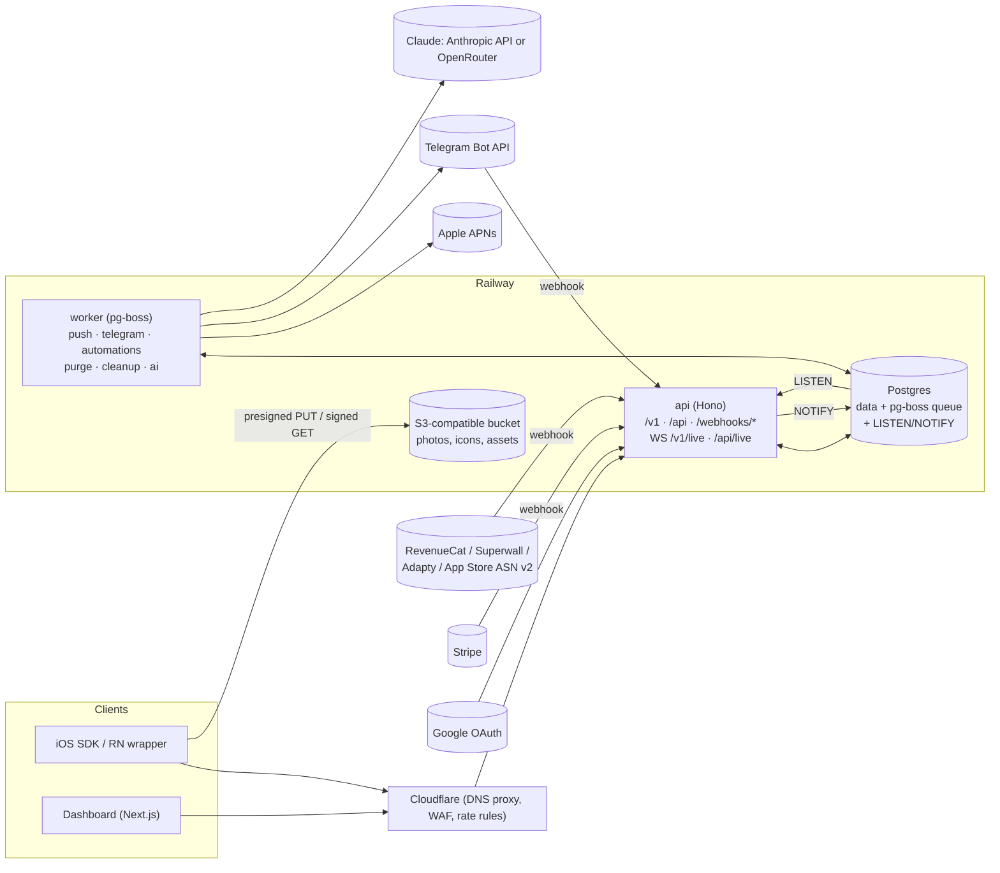

# Backend build plan

How to build the server side of a reception-style product: the API the iOS SDK talks to, the API behind the team inbox, realtime delivery, push, Telegram, subscription webhooks, automations, billing and (later) AI replies.

This plan builds on [`PRODUCT_TEARDOWN.md`](PRODUCT_TEARDOWN.md): §5 (inferred architecture and wire protocol), §6 (full data model) and §7.3 (the hard parts). It turns those into decisions, a repo layout, contracts and a phased schedule with acceptance tests.

---

## TL;DR

| | Decision |
|---|---|
| Language | **TypeScript on Node 22**, one monorepo. Zod schemas shared by the API, the dashboard and generated Swift models. |
| HTTP | **Hono** (`@hono/zod-openapi`), one API service for SDK, dashboard and webhooks. |
| Database | **Postgres 16** + **Drizzle** (schema + migrations). |
| Jobs | **pg-boss** (Postgres-backed queue). Durable delays, cron, retries, and enqueue *inside the same transaction* as the data change. |
| Realtime | Polling for MVP (as reception's own web widget does). Then WebSockets in the API process, fanned out across instances with **Postgres `LISTEN/NOTIFY`**; move to Redis pub/sub only when scale demands it. |
| Files | S3-compatible bucket (**Cloudflare R2** or **Railway Buckets**), presigned PUT with SHA-256 checksum, short-lived signed GET. |
| Auth | Dashboard: **Better Auth** with Google, cookie sessions. SDK: device secret (Keychain) exchanged for 15-min access tokens; verified users via HS256 JWT signed by the customer's server. |
| Push / Telegram / Billing | Direct APNs over HTTP/2 (`jose` for ES256). Telegram Bot API webhooks. Stripe Checkout + Billing Portal + webhooks. |
| Hosting | **Railway**: `api`, `worker`, `dashboard`, `web` services + Postgres + bucket, staging and production environments. (You have Railway and Stripe connected in this workspace; swap freely.) |
| Timeline | **MVP backend ≈ 6–7 weeks** for one experienced TypeScript developer. **Parity without AI ≈ 4 months**, ≈ 4.5 months with AI. Backend only; the SDK and dashboard UI run in parallel. |

Why one Postgres for everything at the start: messages, the job queue, realtime fan-out and rate-limit counters all live in one database you already back up. That is one fewer service to run until real load says otherwise.

---

## Status

**B0–B12 run on Railway staging** (billing on the UGC Mediakits Stripe sandbox in test mode; AI replies on Claude Opus 5.5 through OpenRouter until an `ANTHROPIC_API_KEY` is set) (project `hshelby`, environment `staging`): dashboard at `https://dashboard-staging-0dee.up.railway.app`, API at `https://api-staging-f8f8.up.railway.app`.

B1 (messaging core) as built:

- **SDK API** (`apps/api/src/routes/sdk.ts`): `POST /v1/devices`, `POST /v1/session/refresh`, `PATCH /v1/device`, `GET /v1/conversation?after|before|limit`, `POST /v1/messages`, `POST /v1/read`, `GET /v1/unread`. Device secrets are `dvs_` + 43 chars, stored as SHA-256. Access tokens are 15-minute HS256 JWTs with a key derived (HKDF) from `BETTER_AUTH_SECRET`, so no extra secret to manage; every request re-checks the device, its app and its session version.
- **Ordering and idempotency** (`apps/api/src/messaging.ts`): the §5.2 transaction. The acceptance test (200 concurrent sends, 20% retried `clientId`s → exactly 200 rows, seq 1–200) is in `apps/api/test/messaging.test.ts`. Teammates' replies are idempotent per author and `clientId`.
- **Unread:** each side has a read cursor (`user_read_seq`, `team_read_seq`) and a counter. Sending or replying reads your own side; a read locks the row, then recounts.
- **Inbox API** (`apps/api/src/routes/inbox.ts`): conversations list (status/app filters, keyset cursor), detail, thread paging, reply, read, resolve/reopen, device block/unblock (audited). `conversations.organization_id` is denormalized from the app for the inbox index.
- **Dashboard:** `/inbox` with a polled list and thread (optimistic replies, resolve, block, device details). Onboarding's "waiting for your first message" completes on the first real message.
- **Try it without an app:** `npx tsx apps/api/scripts/sdk-sim.ts --app app_… --api <api url> --say "Hello" --chat` plays the SDK.
- **Deferred to their phases:** rate limits on `POST /v1/devices` (B12).

B4 (identity and deletion) as built:

- **Labels:** `identity: {userId, name, email}` on `POST /v1/devices` and `PATCH /v1/device` (now `{device, identity, identityToken, metadata}`, all optional, applied atomically). Omitted or empty fields keep the server's value. Labels never change a verified device.
- **Verified identity** (`apps/api/src/identity.ts`): HS256 only, keyed with the app's `ids_…` secret verbatim; `user_id` (string ≤255 or safe integer) and `exp` required, future `nbf` refused, 30 s clock tolerance, tokens ≤4,096 characters. `name`/`email` kept when valid, other claims ignored. The device stores the accepted claims, never the token. Errors: `identity_token_invalid` / `identity_token_expired` (422). Test vectors are in `apps/api/test/identity.test.ts`.
- **One user per device:** a different user ID for a device that has one is `identity_mismatch` (409); the app logs out and registers again. Guest → signed-in keeps the conversation.
- **Metadata:** whole-dictionary replace, ≤20 entries, keys 1–64, values ≤512, strings only. `revenuecat_id`, `superwall_id`, `adapty_id` survive updates that omit them.
- **Only verified users can chat** (`apps.only_verified`, admin setting, audited): unverified devices get `verification_required` (403) on send; `GET /v1/conversation` returns `sending: {allowed, reason}` and `identity` so the SDK can say "Sign in to send messages."
- **Secret rotation:** `POST /api/apps/:id/identity-secret/rotate {unverifyExisting}` (admin, audited) invalidates old tokens at once.
- **Logout:** `POST /v1/session/logout {deviceSecret}` ends the device (credential dead, history kept, idempotent). The SDK registers a new device next, which starts a new chat; the inbox marks the old one signed out.
- **Delete:** `DELETE /v1/device` and admin `DELETE /api/devices/:id` (audited) remove the device with its conversations and messages in one statement (foreign-key cascades). Deleted apps are purged by the worker's `purge.deleted-apps` job every 15 minutes, in batches.
- **Dashboard:** names, emails and a verified seal in the inbox, search (name, email, user ID, latest message), user and custom-field details, a signed-out notice, admin "Delete user data", and an app Settings page for the secret, rotation and only-verified mode. The setup prompt gains an identity-verification step.
- **Not yet:** `devices.deleted_at` is unused and will be dropped in a later migration (dropping it now would break the running version mid-deploy).

B3 (push) as built:

- **Package** `packages/push`: an HTTP/2 APNs client (token auth; ES256 provider tokens cached 50 minutes per key; one connection per host), notification content (title/body templates with `{message}`, `{agent}`, `{app}` filled in one pass; title ≤100 and body ≤500 characters; preview and sound switches; sender name; badge = the conversation's unread count unless the app owns its badge; `thread-id` and the conversation ID for tap-to-open), and delivery with outcome handling. `@hshelby/push/testing` has a fake APNs server for tests.
- **Devices:** registration and `PATCH /v1/device` take `push: {token, environment, updatesAppBadge}` (raw APNs token in hex; `null` clears it). A token reported by a new device is removed from the app's other devices; logout clears it.
- **Sending:** a teammate's reply enqueues `push.send` inside its own transaction (pg-boss `fromDrizzle`), keyed by message ID. The worker sends it to the device's environment; Postgres LISTEN/NOTIFY wakes the worker immediately.
- **APNs answers:** 410 drops the token; device rejections (BadDeviceToken, DeviceTokenNotForTopic) are kept as the device's push issue; key rejections (403, BadTopic) flag the app's settings; 429/5xx/timeouts retry with exponential backoff (5 retries) and are recorded on the last attempt. A delivery clears earlier issues.
- **Dashboard:** app Settings has a Push notifications card: `.p8` upload (validated, stored encrypted, never returned; the Key ID is read from Apple's file name), Key/Team/Bundle IDs, templates with a live preview, "Send test" to up to 10 recent devices with per-device results, and remove. Device details show notification status and the last push issue. Changes are admin-only and audited.
- **Not verified here:** delivery to a real iPhone. That needs an Apple key and a device; everything up to Apple's servers is tested against the fake APNs.
- **Deferred:** per-language templates. (Skipping the push while the user is in the chat came with B6, card pushes with B7.)

B2 (photos) as built:

- **Package** `packages/storage`: a client for any S3-compatible bucket (a Railway Bucket on staging; R2 and S3 work the same way), with presigned PUT and GET, one-object-at-a-time deletes (the one delete every provider supports), prefix deletes, and a JPEG/PNG header reader that gets the type and pixel size without decoding. `@hshelby/storage/testing` makes a bucket on a local moto server.
- **Upload:** `POST /v1/uploads {contentType, bytes, width, height, checksum}` (JPEG or PNG, ≤1 MiB, longest side ≤2048 px, base64 SHA-256) stores a pending row and returns a PUT URL valid for 15 minutes, signed with the type, length and checksum. The SDK PUTs the file, then sends `POST /v1/messages {clientId, text, attachmentIds}` (up to 4 photos; text is optional when there are photos). The SDK should re-encode before uploading, which applies EXIF orientation and drops metadata such as location.
- **Verify on send** (`apps/api/src/photos.ts`): before the message is stored, the server reads each object back and checks its size, SHA-256, file signature and dimensions, so it doesn't depend on the provider enforcing the signature. A missing object is `upload_incomplete` (409: PUT again, resend); anything else is `invalid_attachment` (422). Photos are attached inside the message's transaction, and a retried `clientId` returns the stored message with its photos.
- **Reading:** messages carry `attachments: [{id, url, contentType, width, height}]`; `url` is a signed GET that works for 15 minutes, is fresh on every fetch, and serves the type the server checked (not the one the uploader sent). A photo-only message previews as "Photo" in the inbox and "Sent a photo" in a push.
- **Limits:** 20 unsent uploads per device (`too_many_uploads`, 429); blocked devices, and unverified ones in only-verified mode, can't upload. An upload has to be sent within 23 hours.
- **Cleanup:** the worker's hourly `maintenance.unsent-uploads` job removes uploads still unsent after 24 hours, object first, then row. The hour between the send window and the sweep means a send never attaches a photo the sweep is deleting. Deleting a device (SDK or admin) deletes its photos first; purging an app deletes the app's.
- **Teammates:** `POST /api/conversations/:id/attachments` (multipart `file`; the 1.1 MB body limit applies to that route only) checks and stores the photo, and the reply sends it with `attachmentIds`. The dashboard redraws each picked photo in the browser (EXIF orientation applied, metadata dropped, longest side 2048 px, PNG kept when it fits, otherwise JPEG at falling quality until ≤1 MB), uploads it as soon as it's picked, and shows photos in the thread with a full-size viewer.
- **Without a bucket** (no `S3_*` variables) photos are off: uploads answer `uploads_not_configured` (503) and text messaging works as before.
- **Simulator:** `--photo PATH` (repeatable) and `--caption` run the SDK's upload flow.
- **Checked on staging** (Railway Bucket): the bucket itself refuses a PUT whose bytes don't match the signed SHA-256 (400 `XAmzContentSHA256Mismatch`) or whose length or content type differs (403 `SignatureDoesNotMatch`); an unsigned GET is 403, and signed GETs come back with the overridden type. The server's own checks stay, since other providers (and the moto server in tests) don't enforce these.
- **Deferred:** thumbnails (the dashboard and SDK show the ≤2048 px original), photos in Telegram (B8).

B5 (billing) as built:

- **Rules** (`packages/billing`): one subscription per workspace. `active`, `trialing` and `past_due` (Stripe retrying a failed renewal) keep paid features on; anything else (`canceled`, `unpaid`, `incomplete`…) turns them off. With billing switched off (no Stripe variables), nothing is gated.
- **Gating** (402 `subscription_inactive`): teammates' replies and photo uploads, a second app, and invitations (Better Auth's `beforeCreateInvitation`). Never gated: anything end users do, reading the inbox, resolve and block, deleting a user's data, settings. Before subscribing, the team can reply in each app's setup conversation (its first conversation, from the developer's test device: `apps.setup_conversation_id`), as reception allows.
- **Checkout and portal:** Better Auth's Stripe plugin (`/api/auth/subscription/upgrade` and `/billing-portal`, webhooks at `/api/auth/stripe/webhook`, and the return from Checkout, which records the subscription even before its webhook arrives). A guard sells only the plan on offer, only as a workspace subscription, only to owners and admins of a workspace that isn't subscribed. Card changes, plan changes and cancellation happen in Stripe's billing portal.
- **Founder spots:** the founder prices (`STRIPE_PRICE_MONTHLY`, `STRIPE_PRICE_YEARLY`) are on sale until `FOUNDER_SPOTS` (default 50) workspaces hold a founder subscription that is still on; then the standard prices are. A founder who leaves frees a spot. The count is checked when Checkout starts, so two workspaces racing for the last spot can both get it. Without standard prices set, the founder price stays on sale. Amounts come from Stripe, cached for 10 minutes. `GET /public/pricing` (no auth, any origin, cached 60 s) gives the landing page the offer and the counter.
- **Backstop:** the plugin answers 200 even when applying a webhook fails, so the worker's hourly `billing.sync` re-reads every subscription Stripe may still change and fixes rows that drifted. It needs `STRIPE_SECRET_KEY` on the worker.
- **Dashboard:** a Billing page (plan, renewal or end date, a past-due notice and "Manage billing", or else the offer with the founder counter and Subscribe), an inbox banner while unsubscribed or past due, a composer that says why it's locked (and marks the setup conversation), "Add app" leading to Billing when locked, and the onboarding Subscribe step showing the live offer.
- **Tests** run the real plugin against a fake Stripe (`@hshelby/billing/testing`): checkout and webhooks turn replies on; cancel-at-period-end and past-due keep them on; the end turns them off while the user's messages keep arriving; the return from Checkout works without the webhook; the plan, admin and founder-cap guards; a forged webhook is refused; the sync job fixes missed changes. A browser walkthrough runs the same loop through the fake's Checkout and portal pages.
- **Staging Stripe:** the shared "UGC Mediakits" sandbox has a product `hshelby (staging)` with the four prices and a webhook endpoint for the staging API (API version `2026-04-22.dahlia`); their IDs and the webhook secret are set on the api service. The sandbox's test secret key is set as `STRIPE_SECRET_KEY` on the api service (the worker references it). Checked 2026-10-29: a new workspace subscribed through Stripe Checkout with the 4242 test card, came back to `/billing?subscribed=1` and was `active` on the `founder` plan within seconds of the webhook. The sandbox is shared, so the endpoint also receives other projects' subscription events; the plugin ignores prices it doesn't know.

B6 (realtime) as built:

- **Endpoints:** `GET /v1/live` (SDK; access token in the `Authorization` header) and `GET /api/live` (dashboard; session cookie, and only from the dashboard's own origin, since browsers send cookies on cross-site WebSocket handshakes) upgrade to WebSocket on the API's port (`apps/api/src/realtime/gateway.ts`). The dashboard connects to its own origin; Next's rewrite proxies the upgrade to the API.
- **Events, not data** (`packages/contracts/src/realtime.ts`): `message {seq}`, `read {seq}` and `typing` to the SDK; `message`, `conversation` (status or read state changed), `typing` and `presence` to dashboards. Every connection starts with `ready`; `resync` means events may have been missed. Either way clients catch up once with `after=seq`.
- **Fan-out:** messages, reads and status changes publish `pg_notify('rt', …)` inside their own transactions, so nothing is announced before it commits and a rolled-back change never is. Every instance keeps one connection that LISTENs and routes events to its sockets: dashboards by organization, the SDK by device. If that connection drops, it reconnects with backoff and tells every socket to resync. `realtime/fanout.ts` is the only file to change for Redis pub/sub.
- **Typing:** relayed through the same channel, never stored, throttled to one event per 2 s per sender, and never echoed to the teammate typing. A typing indicator lasts 5 s.
- **In chat:** the SDK's socket is open only while the chat is on screen. Opening sets `devices.chat_open`; heartbeats (the SDK's every 15 s, and the server's pings) refresh `last_seen_in_chat_at` at most every 20 s; closing clears it. "In chat" means open and seen within 45 s, so a crashed instance's sockets stop counting on their own. The worker **skips the push** for a reply to a device that's in chat (`in_chat` outcome).
- **Safety:** 4 KB message limit, 40 messages per 10 s per socket, pings every 15 s to drop dead connections. SDK sockets close with 4001 after 15 minutes (the access token's lifetime) and dashboard sockets after an hour, so credentials are rechecked on reconnect: a logged-out or deleted device can't stay connected.
- **Dashboard:** one socket per tab with reconnect and backoff. The inbox and the open thread update live; polling drops to every 30 s while the socket is up (3–5 s otherwise). It shows "In chat" badges, "Chat open" in the device details, and typing both ways.
- **Simulator:** `--chat` uses the live socket (heartbeats, typing on keypress, team typing and read receipts printed) and polls only while it's down.
- **Done-when test** (`apps/api/test/realtime.test.ts`): two API instances on one database; a reply sent through A reaches a dashboard socket and the user's socket on B in 17–19 ms locally, including the HTTP request and the transaction (the target is under 300 ms). The same file covers read receipts, workspace isolation, resync after a dropped listener, typing, presence and refused credentials.

B7 (cards) as built:

- **Paywall reports:** `POST /v1/devices` and `PATCH /v1/device` take `paywalls: [{id, title, source, presentable, products}]`, the paywalls the app can show right now (IDs 1–64 of `[A-Za-z0-9_.-]`, titles ≤60, at most 20 paywalls and 40 products, IDs unique). Each report replaces the device's list (`devices.available_paywalls`, `paywalls_reported_at`); omitting it leaves the list alone, `[]` clears it. Reports also feed the app's registry (`app_paywalls`), which rewrites a row only when it changed or is over an hour old, so an SDK that reports on every foreground doesn't write every time.
- **Cards** are agent messages with `kind` `review` or `paywall` and a stored `card` (`messages.card`). `POST /api/conversations/:id/cards {kind, clientId, text?, buttonLabel?, scenario? | paywallId, confirmRepeat?}` goes through the same append transaction as replies (seq, idempotent `clientId`, push, live event) and is gated like replies.
  - An **offer** must name a paywall the device last reported and can present, else 422 `paywall_unavailable`. The card keeps the paywall's title as it was when sent; the SDK sees only `{type, paywallId, buttonLabel}`.
  - A **review** needs the app's App Store ID (`app_store_id_required`, 422), which admins set on the app (`PATCH /api/apps/:id {appStoreId}`, audited). The review URL is computed when the message is read, so changing or clearing the ID updates older cards (no ID: the SDK shows the text without a button). Sending one sets `devices.review_asked_at`, which automations will use to skip people already asked. `{app}` in the text becomes the app's name.
  - **Repeat guard:** if the last card of the same kind got no reply from the user, another one needs `confirmRepeat` (409 `card_repeat_unconfirmed`); the dashboard asks the teammate to type "send review" or "send offer". It runs inside the transaction, with the conversation row locked.
  - A null `buttonLabel` means the SDK's default ("Rate on the App Store", "View offer") in the user's language; admins can set custom labels per app.
- **Click receipts:** `POST /v1/actions/:messageId/click {clickedAt?}` records the first tap on one of the device's cards (`messages.action_clicked_at`) and answers `{actionClickedAt, first}`; later or concurrent taps return the first one. A receipt the SDK cached offline may carry its tap time, kept between the card's sending and now. The first tap publishes an `action` event, so the dashboard shows "Alex opened the Pro yearly paywall" live.
- **Settings and stats** (`/api/apps/:id/...`): `cards/settings` (review templates for General, After helping and After feedback, ≤500 characters with `{app}`; up to 5 button labels each for reviews and offers; admins change them), `paywalls` (the registry), and `cards/stats?days=7|30|90` (sent, first opens, by sender and by paywall; a partial index on `messages(created_at) where kind <> 'text'` keeps it cheap).
- **Push:** a card with no text pushes "Sent an offer: Pro yearly" or "Asked for a rating". The in-chat skip applies as for replies.
- **Dashboard:** "Ask for review" and "Send offer" in the composer (templates, the device's reported paywalls only, label choice, the repeat confirmation), cards rendered in the thread with their tap receipts, "Paywalls" and "Review asked" in the details panel, and a Reviews and offers card (App Store ID, templates, labels, activity) plus a Paywalls card on the app's settings page.
- **Simulator:** `--paywall id=Title` (repeatable) reports paywalls; in `--chat`, cards print with their button and `/tap` sends the click receipt.
- **Done-when tests** (`apps/api/test/cards.test.ts`): an offer for an unreported (or unpresentable, or no longer reported) paywall is refused; five racing taps record exactly one first tap, and later taps return it. The same file covers the registry, malformed reports, the review link and App Store ID permissions, the repeat guard, resends, stats and settings.
- **Deferred:** per-language templates and "Suggested" offer text in the user's language; "Reset support" (which would keep card history).
- **Checked on staging:** the browser walkthrough (settings, an offer, the tap, the repeat guard, stats) runs against the staging dashboard; the tap receipt shows in the thread about 370 ms after the tap.

B8 (Telegram) as built:

- **Package** `packages/telegram`: a Bot API client (Telegram's errors as data: retry_after, migrate_to_chat_id, chat gone, thread gone), message formatting (HTML, escaped, cut at 3,500 characters), the delivery logic shared by the API and the worker, and `@hshelby/telegram/testing`, a fake Bot API with bots, chats, topics, reactions, webhooks with secret tokens, a per-chat rate limit, migrations and planned failures.
- **Connecting** (`PUT /api/apps/:id/telegram {botToken, chatId}`, admins, audited): checks the token (`getMe`) and the chat (`getChat`; channels refused), sets the bot's webhook to `/webhooks/telegram/<bot>` with a fresh secret token (stored as SHA-256), posts a confirmation, and stores the connection. The token is encrypted with `ENC_KEYS` and never returned. A bot belongs to one workspace (`telegram_bot_in_use`, 409) but can serve several of its apps, since Telegram allows one webhook per bot. `PATCH` pauses or switches topics (refused unless the chat is a forum and the bot can manage topics), `POST …/test` posts a test, `DELETE` disconnects and, for a bot nothing else uses, removes the webhook and forgets the token.
- **Out** (jobs `team.notify` → `telegram.send`): every message enqueues `team.notify` in its own transaction. A customer's message is posted as "**App · User** ✓" (the check for verified users) with its text, "📷 Photo" for photos (files aren't forwarded) and a description for cards. A reply written in the inbox, by an automation or the AI is mirrored silently as a Telegram reply under the customer's latest notification. Nothing is posted while paused, and nothing missed is replayed.
- **Pacing:** at most one post per chat every `TELEGRAM_CHAT_INTERVAL_MS` (3 s, i.e. Telegram's ~20 a minute per group). `team.notify` reserves the chat's next slot (`telegram_chats.next_slot_at`) and schedules the send there; each send also waits, under the chat's row lock, until the interval since the chat's last send has passed, so retries and catch-up after downtime can't burst. A 429 pushes the chat's slot back by `retry_after` and reschedules the job. One worker takes sends in slot order, so a chat's posts keep the order they were written in.
- **In** (`POST /webhooks/telegram/:botId`, secret token checked in constant time): a team member's Reply to a notification or a mirrored answer (or, with topics, any message in the customer's topic) becomes a team reply in the app (`source: telegram`), with its push. Only plain text up to 4,000 characters; bots, anonymous admins, forwards, media and edits are ignored. The reply is attributed to the workspace's only member, or to the team when there are several. The bot reacts 👍 once it's saved, or answers "Reply sent." where reactions are off; too-long replies and replies while the subscription is inactive get a short notice instead. A redelivered update is a no-op (`telegram_posts` key).
- **Chat changes:** a group upgraded to a supergroup is followed, both from the migration update and from the error on the next post, and posts, topics and the connection move with it. A bot removed from the chat records the reason on the connection, shown in settings. With topics on, each customer gets a forum topic "App · User" (renamed when the name changes, recreated if deleted); without the rights, posts fall back to the main chat and the connection says why.
- **Worker queues:** `push.send`, `team.notify` and `telegram.send` now fetch up to 10 jobs at a time and keep fetching while the queue returns full batches, settling each job on its own (one failure retries only that job). Before, pg-boss waited for its 30 s backstop poll after a NOTIFY wake-up, so a burst of replies could take minutes.
- **Dashboard:** a Telegram card on the app's settings page (BotFather steps, connect, status, pause, topics, test, disconnect, the last refusal), and "via Telegram" on replies sent from there.
- **Done-when tests:** `apps/api/test/telegram.test.ts` (a Reply in Telegram lands in the app chat once, with the 👍; connecting, refusals, pausing, mirrors, routing and what's ignored, too-long replies, a forged secret, reactions off, several teammates, a migrated group, a removed bot, topics, a 429) and `apps/worker/test/telegram.test.ts` (a burst of 50 customer messages is posted in order with no 429 from a fake Telegram that allows 20 per window, scaled to a 110 ms interval).
- **Not checked here:** a real Telegram group (needs a bot token from BotFather). Everything up to Telegram's API runs against the fake; on staging, connecting with a made-up token gets Telegram's own refusal.

B9 (appearance and assets) as built:

- **The document** (`packages/contracts/src/appearance.ts`): every remote option of the SDK's Appearance except the font family: colors per mode (`{light, dark}`, 6-digit hex), color scheme, title, welcome title and welcome text per language (BCP 47 keys, up to 48), the three hide switches, welcome icon (SF Symbol, library image or hidden) with size, corner radius and offset, font design, close button and icon, fading older messages, and card styling (button and trailing icons, icon size 8–28, button and text colors). Every key is optional: absent means the app's own value, then the SDK's default. Unknown keys are refused.
- **Draft and publish** (`/api/apps/:id/appearance`, admins edit; `app_appearance`): `PUT …/draft {document, baseVersion}` saves only if nobody saved since `baseVersion` (409 `appearance_conflict` otherwise; the editor offers to reload). `POST …/publish {draftVersion}` copies that exact draft to the published document, so nobody publishes changes they haven't seen, and is audited. `POST …/discard` resets the draft to what's published. No autosave, no history.
- **For the SDK** (no credentials, before registering): `GET /v1/apps/:appId/appearance` returns `{version, appearance, team}` with only the published document (null until the first publish), `Cache-Control: public, max-age=60` and an ETag that changes with each publish or team switch (304 for a cached copy). Library images come as URLs, `GET /v1/assets/<id>.png`, served only while some published design uses them (`published_asset_ids`, GIN-indexed) and cached as immutable. Drafts and draft-only images never leave the dashboard.
- **The app's own design:** `PATCH /v1/device` (and registration) take `appearance`, the SDK's local values (bundled images as `{type: "bundled"}`), stored per app when changed or over an hour old. The editor offers "Start from it".
- **Asset library** (`/api/assets`, shared by the workspace's apps, admins add and delete): SVG, PNG, JPEG or WebP up to 2 MB, checked by content, converted with sharp to a transparent PNG of at most 512 px (vectors rendered at full size, bitmaps never enlarged); the original is discarded. SVGs with scripts, external references, entities or foreign objects are refused. 50 MB per workspace. An image any draft or published design uses can't be deleted (`asset_in_use`), and a design can only use its own workspace's images.
- **Team photos and names:** two per-app switches (`PATCH /api/apps/:id/team-display`) that apply at once, without publishing. Teammates upload a profile photo on their account page (`PUT /api/me/photo`: cropped square, 256 px JPEG, metadata dropped). SDK messages from a teammate carry `author: {name, initial, photoUrl}`: the first name with names on, and a one-hour link to the photo (or the initial without one) with photos on; null otherwise.
- **Dashboard:** a Chat design editor (`/apps/:id/appearance`: colors per mode, texts per language, icons, font, close button, card styling, team switches, a live light/dark phone preview, Save draft / Publish / Discard, the conflict notice), an Asset library page with the quota, and an account page for the profile photo.
- **Done-when tests** (`apps/api/test/appearance.test.ts`): the SDK gets nothing before the first publish, the published document after it, and never a later draft; images in drafts aren't served; stale saves and publishes are refused; ETag/304; validation and admin-only editing; conversion of JPEG, WebP and SVG, unsafe SVGs and oversized files refused, in-use images kept; reply authors with names and photos switched on and off.
- **Deferred:** the 48 built-in languages' matching rules live in the SDK; "Users" page and per-teammate team names (the user's account name is used).
- **Checked on staging:** the same walkthrough runs against staging (Railway Bucket, sharp on Railway): the SDK gets nothing before publishing, the design after, the icon PNG from `/v1/assets`, and reply authors with photo links.

B10 (subscriptions and automations) as built:

- **Package** `packages/subscriptions`: verification and normalization for the four providers, and `@hshelby/subscriptions/testing` (fixtures shaped like each provider's documented payloads, with the canonical event each should become, and an App Store signer on a test certificate chain).
  - **RevenueCat** and **Adapty**: an Authorization header value we generate (`Bearer …`, encrypted at rest, shown to admins), compared in constant time. Adapty's URL check (an empty `{}` when the webhook is saved) gets `{}`.
  - **Superwall**: its `whsec_` signing secret, Svix-style HMAC over `id.timestamp.body` (`webhook-*` or `svix-*` headers), timestamps within 5 minutes. Refunds are its transactions with a negative price.
  - **App Store Server Notifications v2**: no secret. The `signedPayload` JWS and the transaction inside it must carry a three-certificate x5c chain ending at Apple Root CA - G3 (embedded, SHA-256 `63:34:3A:…:91:79`), with Apple's marker extensions on the intermediate and signing certificates, valid dates and an ES256 signature; the bundle ID must match the app's.
  - **Normalization** to the ten canonical events (`trial_started`, `trial_converted`, `trial_cancelled`, `trial_expired`, `subscription_started`, `subscription_renewed`, `subscription_cancelled`, `billing_issue`, `subscription_expired`, `refunded`). Uncancellations, product changes and the like are accepted and ignored; tests are logged as tests. Apple's converted trial is a plain renewal.
- **Receivers** at `/webhooks/{revenuecat,superwall,adapty,appstore}/<public App ID>`: verify, normalize, then in one transaction record the event (unique per app, provider and event ID, so redeliveries are no-ops), match the person, update their devices' subscription state (`devices.subscription`: status, paying, product, expiry) and queue `automation.event`. Refusals (bad secret or signature, not connected, wrong bundle ID, unreadable payload) are logged too.
- **Matching:** the app's user ID, the provider's sticky metadata key (`revenuecat_id`, `superwall_id`, `adapty_id`), a StoreKit original transaction ID the SDK reported (`PATCH /v1/device {storekit: {originalTransactionIds, paying}}`, kept across reports, at most 50), or an App Store `appAccountToken` equal to the user ID; then every signed-in device with the same user ID.
- **Automations** (`/api/apps/:id/automations`, admins edit): a trigger (an event the app tracks, or one of the ten), once per person or every time after the previous run, an audience (everyone / without / with a subscription, up to four metadata rules, "also during a conversation"), a wait (right away, a delay, or a local time on a later day), push on or off (offers always push), up to eight steps (message, offer, rating, wait, open chat) and a sender (a teammate or the team).
- **The engine** (`apps/api/src/automations`): an event starts a run per matching automation (an advisory lock keeps simultaneous events from starting two). People blocked, signed out, outside the audience or in a conversation from the last 24 hours are skipped (and a later event catches them). Before anything is sent, every offer must be a paywall the device can show and a rating needs the App Store ID and someone not yet asked; otherwise the run is **held** and retried at the person's next event. Steps after a wait are re-checked: a reply, an audience change or a gone offer **ends** the run. Each message and the run's move past its step commit together (guarded by the step index), so a retried job never sends twice. Switching an automation off ends its scheduled runs.
- **Waits** are `automation.step` jobs with `startAfter`; "tomorrow at 10:00" is computed in the device's time zone with Intl (DST changes and skipped hours handled, UTC without a zone). Automation jobs run in the API process (they only write messages, through the same code as replies), polled every 10 s.
- **Delivery:** messages from automations are `source: automation`, unread, with one push if on. A conversation an automation starts stays out of the inbox (and out of Telegram) until the person writes.
- **SDK:** `POST /v1/track {event}` runs automations for the event and answers `{sent, openChat}` after any immediate sends; `GET /v1/track/events` lists the events enabled automations listen for (refetch after 5 minutes). Subscription events can't be tracked from the app.
- **Results** (`…/automations/:id/results`): got the message, opened the offer or tapped Rate, replied, bought within 7 days (a start, trial or conversion event for the device), the scheduled queue and the skipped, held and ended runs with reasons.
- **Dashboard:** Subscription providers on the app's settings page (connect, webhook URL and Authorization value to copy, Superwall secret, App Store steps, Recent events), an Automations page (list, on/off, builder, results), and the person's subscription in the inbox details.
- **Simulator:** `--track event` (or `/track event` in `--chat`), `--storekit-tx ID`, `--paying`.
- **Done-when tests:** `packages/subscriptions/test` replays every provider's fixture set to the expected canonical events (56 cases, plus signature refusals); `apps/api/test/automations.test.ts` sends a real RevenueCat cancellation for people in Los Angeles, Berlin and Tokyo and checks each run (and its job) is due at 10:00 the next day in their zone (17:00, 09:00 and 01:00 UTC), then sends the offer. The same files cover the receivers, matching, dedupe, audiences, suppression, holds, waits and re-checks, exactly-once steps, results and permissions.
- **Not checked here:** real deliveries from the providers (they need accounts and live webhooks); everything is tested against their documented payload shapes.
- **Checked on staging:** a RevenueCat cancellation webhook reached the person's app as an automation message 1.35 s later; a tracked `paywall_declined` answered `{sent: true, openChat: true}`.

B11 (AI replies) as built:

- **Provider** (`apps/api/src/ai/provider.ts`): Claude directly with `ANTHROPIC_API_KEY`, or Claude through OpenRouter's Anthropic-compatible Messages API (`https://openrouter.ai/api`, key as a bearer token) with `OPENROUTER_API_KEY` when there's no Anthropic key, so adding one switches over with no code change. Same SDK, tool runner, strict tools, effort and prompt caching either way; OpenRouter rejects Anthropic's server-side fallback, so through it a decline goes straight to a handover. OpenRouter could serve Claude from Anthropic, Amazon Bedrock, Google Vertex or Azure; requests are pinned to `OPENROUTER_PROVIDERS` (default `anthropic`, no fallback) and to providers that neither keep nor train on the data (`data_collection: deny`), which keeps [`SUBPROCESSORS.md`](SUBPROCESSORS.md) true. `AI_MODEL` overrides the model (default `claude-opus-5-5` directly, `anthropic/claude-opus-5.5` through OpenRouter).
- **Model:** Claude Opus 5.5 through `@anthropic-ai/sdk`'s tool runner, `output_config: {effort: "low"}`, `max_tokens` 16,000 (thinking is always on and counts toward it), at most 4 model calls per turn. Directly, server-side fallbacks are on (`fallbacks: "default"`, beta `server-side-fallback-2026-07-01`): when Opus declines, Anthropic's recommended fallback model answers in the same call, and the run records that it did. The runner sends the whole turn each time (`thread: false`), so no conversation is kept on Anthropic's side.
- **Prompt** (`apps/api/src/ai/prompt.ts`): the tools and a system prompt of rules, the team's instructions and the app's docs, marked for prompt caching, so every conversation of an app reads the docs at the cached rate. The user turn carries the person (name, locale, local time, app and iOS version, subscription, the offers their device can show, whether a rating request is available) and the latest 30 messages, labelled by who wrote them (photos and cards as placeholders), as data, not instructions.
- **Tools** (`apps/api/src/ai/assistant.ts`, `strict: true`, `tool_choice` auto): `reply(text)`, `send_offer(paywall_id, text)`, `ask_review(text)`, `handover(reason, message)`. Guardrails live in their code: an offer must be a paywall the person's device reported it can show; a rating request needs the App Store ID and nobody asked in the last 120 days, plus the cards' repeat guard; nothing may promise a refund (English phrasings, a backstop for the prompt's rule); a turn sends at most one message (reply and handover can go together). A refused call goes back to the model as the tool's error, so it can choose again, and is listed in the run's notes. Apps can turn offers and rating requests off; their tools are then left out.
- **`ai.consider`** (`apps/api/src/ai/consider.ts`, worked in the API process): each person's message schedules a job 8 s later (`AI_DEBOUNCE_MS`), keyed by message; a job whose message is no longer the latest steps aside, so a burst gets one answer, to its last message. A conversation the AI isn't answering, a blocked person, an app with AI off or without a subscription, and a message someone already answered are skipped. While the model thinks, the app shows "Assistant is typing…".
- **No double replies:** every message the AI sends re-checks, inside the send's transaction with the conversation row locked, that the AI still has the conversation and that nothing came after the person's message except this turn's own messages. A teammate's reply (dashboard or Telegram) sets the conversation to `paused` in its own append, so whichever commits first wins and the other stops; a newer message from the person stops the turn too (its own job answers). The tests reply as a teammate while the fake model is "thinking" and check only the teammate's reply went out.
- **Handover:** the conversation becomes `handed_over` with the reason; Telegram gets a post with sound, under the person's latest notification (replying to it answers the person). A refusal by the model and its fallback, a failing model service (after the SDK's 3 retries), a turn with no tool call, and the 31st AI message in a day hand over too. The AI stays out of a paused or handed-over conversation until a teammate hands it back (`POST /api/conversations/:id/ai {state}`; handing back answers the waiting message right away) or resolves it.
- **Messages** are `source: ai`: unread for the team (the AI answering doesn't mark the conversation read), pushed like a reply, mirrored silently to Telegram as "AI". The SDK gets `byAi: true` and, with "Show team names", the AI's name as the author.
- **API** (`/api/apps/:id/ai`): settings (on/off, name, instructions up to 4,000 characters, docs up to 200,000, offers, rating requests; admins; turning on needs the server's key, `ai_unavailable` otherwise; switching and knowledge changes are audited), `POST …/ai/preview` (admins: what the AI would do with a made-up message or a real conversation, with unsaved settings, sending nothing), `GET …/ai/runs` (the last 50: outcome, what it sent, refusals, fallback, tokens, latency) and 30-day totals.
- **Dashboard:** an AI replies page (switch, knowledge, Try it, recent answers with a rough cost), a link on the app's settings, and in the inbox a banner with Pause AI / Hand back to AI, "AI ·" on its messages and "Assistant (AI) is typing…".
- **Eval** (`apps/api/eval`): 24 labelled cases for a made-up app (how-tos, restore, cancel, angry refund demands, asking for a human, offers with and without a paywall, rating requests with and without a recent ask, a crash report, questions the docs don't answer, Spanish, a prompt injection, account deletion, "are you a bot", a burst, a photo, offers switched off), graded in code (the choice, regexes the answer must and mustn't match, the offered paywall). `ANTHROPIC_API_KEY=… npm run eval -w @hshelby/api` (or `OPENROUTER_API_KEY=…`) runs it against the real model (24 model calls, well under a dollar) and fails under 90%. `npm run eval:export -w @hshelby/api -- --app <UUID>` turns an app's resolved conversations into cases with the team's answer as the reference (git-ignored: real people's messages), to label and add.
- **Tests:** `apps/api/test/ai.test.ts` against a fake Messages API (`test/fake-anthropic.ts`): the request shape (model, effort, fallbacks beta, strict tools, cached system), the OpenRouter request (bearer key, its model ID, no fallback) and which key wins, the debounce, pausing and handing back, both double-reply races, retries, each guardrail, refusals, a fallback answer, service failures and the preview. `telegram.test.ts` covers the handover post.
- **Eval result** (2026-10-29, `anthropic/claude-opus-5.5` through OpenRouter): 23/24 (96%), no refusals, $0.17 for the run, median 3.1 s a case. The miss: asked for a free code, it said there's none and sent the real yearly offer instead of only replying. Staging answers through OpenRouter until an `ANTHROPIC_API_KEY` is set; checked there 2026-10-29 on a subscribed workspace: a device's "how do I get my Pro back on a new iPhone?" got the docs' restore steps, marked AI, 16 s after sending (8 s debounce, 6 s model, cached docs). OpenRouter and Anthropic are on the subprocessor list ([`SUBPROCESSORS.md`](SUBPROCESSORS.md)).

B12 (hardening) as built:

- **Rate limits** (`apps/api/src/rate-limit.ts`): fixed windows counted in each API process, `429 rate_limited` with `Retry-After`. Registrations: 30 per hashed address per 10 minutes and 600 per app per minute; token refresh and logout: 120 per address per minute; every SDK call: 300 per device per minute, with sends at 30, photo uploads at 20 and tracked events at 60; the public appearance and library images: 300 per address per minute; webhooks: 1,200 deliveries per URL per minute. The address is Railway's `X-Real-IP`, hashed and kept only for the window. `RATE_LIMIT_SCALE` multiplies them (0 turns them off; a load test raises it). With several replicas each counts its own share; moving the counters to Postgres or Redis changes only that file.
- **Audit log:** `GET /api/audit` (owners and admins; newest first, keyset pages of up to 100) with who did it and to what (app, or person by their label). Invitations, members joining or leaving and role changes (Better Auth's organization hooks), and automations created, changed or deleted are now audited alongside the earlier events. The dashboard's Audit log page (header link for admins) describes each event in words.
- **Load test** (`apps/api/scripts/load-test.ts`): a throwaway workspace and app, 1,000 devices polling `GET /v1/unread` every 5 s (≈200 requests/s) and 50 messages/s from random devices for 3 minutes. On staging (one api replica, Railway's default Postgres) the api's own p95 stayed at 42–47 ms under load and 82 ms in the minute the 1,000 devices registered, with nothing failing; the api peaked at 0.44 vCPU and 225 MB, Postgres at 0.43 vCPU. Postgres pub/sub, in-process rate limits and pg-boss hold this load, so Redis isn't needed yet. How to run it is in [`RUNBOOK.md`](RUNBOOK.md).
- **Restore drill** (`packages/db/scripts/restore-drill.sh`): dump, restore into a scratch database, compare every table's row count and the latest migration. Run on staging 2026-10-29 from a temporary `postgres:18-alpine` service: 20 MB database, dump 1 s (849 KB), restore 1 s, all 45 tables match, latest migration `0011_ai`, 4 s in all. The procedure, the incident restore steps (volume backups, point-in-time recovery) and the results table are in [`RUNBOOK.md`](RUNBOOK.md).
- **Tests:** `apps/api/test/rate-limit.test.ts` (per-address registrations with `Retry-After`, per-device sends while polling still works, windows resetting, scale 0) and `apps/api/test/audit.test.ts` (events with actor and target, paging, admins only, other workspaces see nothing).
- **Not done here:** scheduled volume backups and point-in-time recovery are switches on the Postgres service in Railway's dashboard; turn them on for production (the runbook says which). Cloudflare in front of the API is still optional.

Where B0 differs from the plan below:

- **Sign-in is email + password.** Google comes later; it is one `socialProviders.google` block in `apps/api/src/auth.ts` plus a button.
- **Billing moved partly into B0.** Better Auth's Stripe plugin handles organization subscriptions (plan `founder`, monthly or yearly). It runs in **test mode only**: the API refuses `sk_live_` keys, and billing stays off until all four `STRIPE_*` variables are set. B5 added the gating, founder spots, the portal and the sync backstop (see above).
- **Not done yet:** OpenAPI output from `contracts`, Sentry, email delivery (invitations are logged, not sent).

Railway layout:

| Service | Build / start | Notes |
|---|---|---|
| `api` | `npm run build -w @hshelby/api` / `npm run start -w @hshelby/api` | Pre-deploy `npm run migrate -w @hshelby/api`; healthcheck `/health` (runs `select 1`). Also works the `automation.event`, `automation.step` and `ai.consider` queues. |
| `worker` | same with `@hshelby/worker` | pg-boss: `push.send`, `team.notify` and `telegram.send`, nightly cleanup at 03:00 UTC, deleted-app purge every 15 minutes, unsent-upload sweep and `billing.sync` hourly. |
| `dashboard` | same with `@hshelby/dashboard` | Healthcheck `/health`. Proxies `/api/*` to the API over the private network, so auth cookies are first-party. |
| `Postgres` | Railway template | |
| `photos` | Railway Bucket | Private; read and written only through presigned URLs and the API. |

Service settings live on the services themselves (Railway's JSON config-as-code is deprecated). Watch patterns limit redeploys to the paths each service uses: its app, every workspace package it bundles (directly or through another package), the root `package.json`, `package-lock.json` and `tsconfig.base.json`. When an app gains a workspace dependency, add that package's path to the service's watch patterns, or a change made only in the package won't redeploy it.

Variables (secrets are set in Railway only, never in the repo):

| Service | Variable | Value |
|---|---|---|
| api | `DATABASE_URL` | `${{Postgres.DATABASE_URL}}` |
| api | `BETTER_AUTH_URL` | `https://${{dashboard.RAILWAY_PUBLIC_DOMAIN}}` (the browser's origin) |
| api | `BETTER_AUTH_SECRET`, `ENC_KEYS` | random; `ENC_KEYS` is `v1:<base64 32 bytes>` |
| api | `PUBLIC_API_URL` | `https://${{RAILWAY_PUBLIC_DOMAIN}}` |
| api | `STRIPE_SECRET_KEY`, `STRIPE_WEBHOOK_SECRET`, `STRIPE_PRICE_MONTHLY`, `STRIPE_PRICE_YEARLY` | Stripe sandbox values (the two prices are the founder prices); webhook endpoint `https://<api domain>/api/auth/stripe/webhook` with `checkout.session.completed` and `customer.subscription.created/updated/deleted` |
| api | `STRIPE_PRICE_STANDARD_MONTHLY`, `STRIPE_PRICE_STANDARD_YEARLY`, `FOUNDER_SPOTS` | Optional: the prices after the founder spots (default 50) are taken |
| worker | `DATABASE_URL` | `${{Postgres.DATABASE_URL}}` |
| worker | `ENC_KEYS` | `${{api.ENC_KEYS}}` (decrypts apps' APNs keys) |
| worker | `STRIPE_SECRET_KEY` | `${{api.STRIPE_SECRET_KEY}}` (billing sync; optional) |
| api | `ANTHROPIC_API_KEY` or `OPENROUTER_API_KEY` | Claude for AI replies, directly or through OpenRouter (apps can't turn them on without one; Anthropic wins when both are set); `AI_MODEL` optional (overrides the model), `OPENROUTER_PROVIDERS` optional (default `anthropic`; widening it adds subprocessors), `AI_DEBOUNCE_MS` optional (default 8000) |
| api, worker | `TELEGRAM_CHAT_INTERVAL_MS` | Optional: minimum gap between posts in one Telegram chat (default 3000) |
| api, worker | `S3_ENDPOINT`, `S3_REGION`, `S3_BUCKET`, `S3_ACCESS_KEY_ID`, `S3_SECRET_ACCESS_KEY` | `${{photos.ENDPOINT}}`, `${{photos.REGION}}`, `${{photos.BUCKET}}`, `${{photos.ACCESS_KEY_ID}}`, `${{photos.SECRET_ACCESS_KEY}}` (photos are off without them) |
| dashboard | `API_INTERNAL_URL` | `http://${{api.RAILWAY_PRIVATE_DOMAIN}}:${{api.PORT}}`, read at build time |

---

## 1. What the backend has to do

1. **SDK API** (`/v1`): register devices, issue tokens, sync conversations, accept messages and photos, track read/unread, record card taps, accept app events, serve remote appearance.
2. **Dashboard API** (`/api`): orgs, members, invitations, apps, inbox (list, thread, reply, resolve, block), customer details, settings for push / Telegram / reviews / paywalls / automations / billing.
3. **Realtime**: new messages, typing, read state and "In chat" presence to the phone and to every open dashboard tab.
4. **Outbound work**: APNs pushes, Telegram notifications, automation steps, purges, nightly cleanup, AI replies.
5. **Inbound webhooks**: Telegram, RevenueCat, Superwall, Adapty, App Store Server Notifications v2, Stripe.
6. **Billing and gating**: one subscription per org. If it lapses, users can still write in, but the team can't reply (reception's documented behavior).

Not in this plan, but they consume it: the Swift SDK, the React Native wrapper, the dashboard UI. Section 6 is the contract they build against.

---

## 2. Architecture



**Rule of thumb:** the API does the minimum inside the request (validate → write → enqueue → NOTIFY) and the worker does anything that talks to a third party. So a slow APNs or Telegram call never slows a send, and every side effect retries on its own.

---

## 3. Repo layout

The current landing page moves to `apps/web` in phase B0.

```
apps/
  api/           Hono app: routes, auth middleware, WebSocket gateway, webhook receivers
  worker/        pg-boss consumers + cron schedules
  dashboard/     Next.js inbox (client of the API)
  web/           marketing site (today's src/)
packages/
  contracts/     Zod request/response schemas + error codes → OpenAPI → Swift models
  db/            Drizzle schema, migrations, typed query helpers
  core/          domain logic: messaging, identity, cards, automations, appearance
  integrations/  apns, telegram, stripe, storage, provider normalizers (rc/superwall/adapty/asn)
  testing/       factories, Postgres test harness, webhook fixtures
```

`core` has no HTTP in it, so the API, the worker and tests all call the same functions.

---

## 4. Data model, MVP subset

The full model is in the teardown §6. The MVP needs these tables, with the constraints that matter:

```text
organizations   id, name, stripe_customer_id, sub_status, plan, current_period_end
users           id, email, name, image                (Better Auth also owns sessions/accounts)
memberships     org_id, user_id, role{admin|member}   UNIQUE(org_id, user_id)
invitations     id, org_id, email, role, token_hash, expires_at

apps            id, org_id, public_id 'app_…' UNIQUE, name, icon_key, bundle_id, app_store_id,
                identity_secret_enc, only_verified, appearance_published_json, appearance_version
push_configs    app_id PK, team_id, key_id, p8_enc, title_template, body_template

devices         id, app_id, secret_hash UNIQUE, session_version, user_id_ext, name, email, verified,
                metadata_json, app_version, sdk_version, os_version, model, locale, timezone,
                push_token, push_env{sandbox|production}, push_issue, blocked, last_seen_at, deleted_at
                INDEX(app_id, user_id_ext)

conversations   id, app_id, device_id, status{open|closed}, last_seq bigint DEFAULT 0,
                user_read_seq, team_read_at, unread_for_user, unread_for_team,
                last_message_at, superseded_at
                UNIQUE(device_id) WHERE superseded_at IS NULL   -- one live conversation per device
                INDEX(app_id, status, last_message_at DESC)      -- the inbox query

messages        id, conversation_id, seq, sender{user|agent}, source{sdk|dashboard|telegram|automation|ai},
                author_user_id, device_id, client_id, kind{text|review|paywall}, text, card_json,
                action_clicked_at, created_at
                UNIQUE(conversation_id, seq)
                UNIQUE(device_id, client_id)                     -- idempotent retries

attachments     id, device_id|user_id, message_id NULL, object_key, content_type, bytes, width, height,
                sha256, status{pending|verified}, created_at
```

Conventions:
- Every table that holds customer data reaches `org_id` through `app_id`. Every query goes through a `scoped(orgId)` helper; no raw cross-org queries.
- Secrets (`p8_enc`, `identity_secret_enc`, Telegram tokens, provider secrets) use AES-256-GCM envelope encryption with a versioned master key from env (`ENC_KEY_V1`), so keys can rotate later.
- IDs: UUIDv7 internally (time-ordered); public prefixes (`app_`, `ids_`) only at the edge.

---

## 5. The core flows

### 5.1 Device registration and tokens

1. `POST /v1/devices` with `{appId, device details, identity?, metadata?, push?, identityToken?}`.
2. The server creates a device and returns `{deviceSecret, accessToken, expiresIn}`. `deviceSecret` is 32 random bytes, stored only as SHA-256. The SDK keeps it in the Keychain (`…ThisDeviceOnly`).
3. `accessToken` is a 15-minute HS256 token signed with a server key: `{dev, app, sv: session_version, exp}`.
4. `POST /v1/session/refresh` with the device secret issues a new access token.
5. `logout` and `DELETE /v1/device` bump `session_version`, which kills outstanding tokens.
6. **Verified users:** if `identityToken` is present, verify HS256 against the app's decrypted `ids_…` secret. `user_id` and `exp` are required, max 4,096 chars. On success, set `verified=true` and store the claims, not the token. A different `user_id` from the stored one starts a fresh device session (the teardown's mismatch rule). When `only_verified` is on, reject unverified sends with `verification_required`.

### 5.2 Sending a message (the heart of it)

Ordering and no duplicates come from one short transaction:

```sql
BEGIN;
-- 1. Lock (or create) the device's live conversation and take the next seq
UPDATE conversations
   SET last_seq = last_seq + 1, status = 'open',
       last_message_at = now(), unread_for_team = unread_for_team + 1
 WHERE device_id = $device AND superseded_at IS NULL
RETURNING id, last_seq;            -- row lock serializes concurrent sends
-- (if no row: INSERT the conversation first, then repeat)

-- 2. Insert; UNIQUE(device_id, client_id) turns a retried send into a conflict
INSERT INTO messages (conversation_id, seq, sender, source, device_id, client_id, kind, text)
VALUES ($conv, $seq, 'user', 'sdk', $device, $clientId, 'text', $text);

-- 3. Side effects ride the same transaction (outbox): never lost, never sent for a rolled-back row
--    boss.send('team.notify', {messageId}, {db: tx})   -> Telegram + dashboard counters
--    boss.send('ai.consider', {conversationId}, {db: tx, singletonKey: conv, startAfter: 8})
SELECT pg_notify('rt', json_build_object('conv', $conv, 'seq', $seq)::text);
COMMIT;
```

On a unique violation for `(device_id, client_id)`, roll back and return the stored message: the client sees success and still has exactly one copy (reception's checklist tests this explicitly). Agent replies from the dashboard, Telegram, automations and AI all go through the same `core.appendMessage()` with a different `sender`/`source`, and enqueue `push.send` instead of `team.notify`.

### 5.3 Reading, unread, sync

- `GET /v1/conversation?after=<seq>` returns the conversation plus messages after `seq` (or the latest 50). It's used for the first load, polling, and catch-up after a WebSocket reconnect.
- `POST /v1/read {seq}`: `user_read_seq = GREATEST(user_read_seq, $seq)`, then recompute `unread_for_user`.
- `GET /v1/unread` is cheap and index-only, and it's what the SDK polls when the chat is closed. Polling stops once push works (reception does the same, and it's what keeps idle installs from hammering you).

### 5.4 Photos

1. `POST /v1/uploads {contentType, bytes, width, height, checksum}`: validate JPEG/PNG, ≤ 1 MiB, ≤ 2,048 px. Create a pending attachment and return a presigned PUT carrying `x-amz-checksum-sha256` and `If-None-Match: *`.
2. The client PUTs straight to the bucket.
3. `POST /v1/messages {…, attachmentIds}`: the server HEADs each object (size and checksum match), marks it verified and links it to the message.
4. Reads use signed GET URLs that live 15 minutes. A nightly `cleanup` job deletes pending uploads older than 24h.

### 5.5 Realtime (phase B6)

- `GET /v1/live` (SDK) and `GET /api/live` (dashboard) upgrade to WebSocket and authenticate with the access token or the session cookie.
- Every API instance runs one `LISTEN rt`. On each notification it forwards `{type:'message.created', conv, seq}` to sockets subscribed to that conversation or app. Clients fetch with `after=seq`, so NOTIFY payloads stay tiny (well under Postgres's 8 KB limit).
- Typing: client → server → peers, never stored.
- Presence: the SDK sends a heartbeat every 15 s while the chat is visible. The server writes `last_seen_in_chat_at` at most once a minute. "In chat" means seen in the last 45 s.
- **Skip push** for an agent reply when the device is "In chat". That saves APNs calls and stops the double ping.
- When one Postgres connection per instance becomes a limit (dozens of instances), switch fan-out to Redis pub/sub. Only `realtime/fanout.ts` changes.

### 5.6 Push (`push.send` job)

- Per app: encrypted `.p8`, Key ID, Team ID. Provider JWT (ES256 via `jose`), cached about 50 min per (team, key).
- `node:http2` sessions to `api.push.apple.com` / `api.sandbox.push.apple.com`, chosen by the **device's** `push_env`. Headers: `apns-topic = bundle_id`, `apns-push-type: alert`. Body: templated title and body, `thread-id = conversationId`, a custom key for the conversation, and `badge = unread_for_user` when the device opted in.
- Responses:

  | Response | Action |
  |---|---|
  | `410 Unregistered` | clear the token |
  | `400 BadDeviceToken` / `DeviceTokenNotForTopic` | store as the device's push issue (shown in the dashboard) |
  | `403 InvalidProviderToken` | flag the app's push config |
  | `429` / `5xx` | retry with backoff |

- Job `singletonKey = messageId`, so one push per message even under retries.

### 5.7 Telegram

- The customer pastes their own bot token (from BotFather). The server calls `setWebhook` with `secret_token` and checks it on every update (`X-Telegram-Bot-Api-Secret-Token`).
- **Outbound** (`team.notify`): `sendMessage` to the linked group, then store `telegram_posts(chat_id, message_id → conversation_id)`.
- **Inbound:** a reply → `reply_to_message.message_id` → conversation → `core.appendMessage(source='telegram')` → 👍 reaction via `setMessageReaction`.
- Handle `migrate_to_chat_id` (a group upgraded to a supergroup). Throttle to about 20 messages/min per group with a per-chat pg-boss throttle.

### 5.8 Subscription webhooks → automations (phase B10)

1. Verify each provider:

   | Provider | Check |
   |---|---|
   | RevenueCat | auth header |
   | Superwall | `whsec_` HMAC |
   | Adapty | auth header + URL check |
   | App Store ASN v2 | JWS x5c chain to the Apple root + `bundleId` |

2. `INSERT provider_events … ON CONFLICT (provider, provider_event_id) DO NOTHING`. Providers retry, so this keeps processing idempotent.
3. Normalize to canonical events (trial_started, trial_converted, renewed, cancelled, expired, billing_issue, refunded…).
4. Match devices by user ID, sticky provider IDs, or `originalTransactionId`. Update plan and status metadata.
5. `automation.evaluate` creates `automation_runs`. Each step is a pg-boss job with `startAfter`, computed in the device's time zone for "tomorrow at 10:00" waits. Every step re-checks enablement, the audience rules and the 24h ongoing-conversation suppression, and holds the run if an offer or rating can't be sent.

### 5.9 Billing

- Stripe Checkout (subscription mode, monthly and yearly prices) plus the Billing Portal.
- Webhooks `checkout.session.completed`, `customer.subscription.updated|deleted` and `invoice.payment_failed` → `organizations.sub_status`.
- A `requireActiveSubscription` middleware guards team-side writes (reply, cards, new apps, invites). SDK writes from end users are **never** gated.

---

## 6. API contract (what the SDK and dashboard build against)

All bodies are Zod-validated. Errors use `{error: {code, message}}` with stable codes (`verification_required`, `identity_changed`, `upload_incomplete`, `device_blocked`, `subscription_inactive`, …). OpenAPI is generated from `packages/contracts`, and Swift `Codable` models are generated from the OpenAPI.

**SDK `/v1`** (Bearer access token unless noted)

| Method & path | Purpose |
|---|---|
| `GET /v1/apps/:appId/appearance` | Public remote appearance, cacheable (no auth) |
| `POST /v1/devices` | Register; returns device secret + access token (App ID auth) |
| `POST /v1/session/refresh` | Device secret → new access token |
| `PATCH /v1/device` | Update details, identity, metadata, push token, available paywalls |
| `GET /v1/conversation?after=` | Sync / poll / catch-up |
| `POST /v1/messages` | Send `{clientId, text, attachmentIds}` |
| `POST /v1/uploads` | Presign a photo upload |
| `POST /v1/read` | Advance read cursor `{seq}` |
| `GET /v1/unread` | Unread count for badges |
| `POST /v1/actions/:messageId/click` | Card tap receipt (first tap wins) |
| `POST /v1/track` | App event `{event}` → `{sent, openChat}` |
| `POST /v1/session/logout` · `DELETE /v1/device` | Logout / delete data |
| `GET /v1/live` (WS) | Live stream while the chat is open (phase B6) |

**Dashboard `/api`** (session cookie, org-scoped): `orgs`, `members`, `invitations`, `apps` (+ secrets reveal/rotate), `conversations` (list with `status`/`app`/search, cursor pagination), `conversations/:id/messages` (reply, review card, offer card), `conversations/:id/{resolve,reopen}`, `devices/:id` (details, block, reset), `push-config`, `telegram`, `providers`, `automations`, `billing/{checkout,portal}`, `GET /api/live` (WS).

**Webhooks:** `/webhooks/telegram/:connectionId`, `/webhooks/revenuecat/:appId`, `/webhooks/superwall/:appId`, `/webhooks/adapty/:appId`, `/webhooks/appstore/:appId`, `/webhooks/stripe`.

---

## 7. Jobs and schedules

| Job | Trigger | Idempotency | Retry |
|---|---|---|---|
| `push.send` | agent message to a device not "In chat" | `singletonKey = messageId` | 5× exponential, then mark push issue |
| `team.notify` | user message | `singletonKey = messageId` | 5× |
| `telegram.send` | from `team.notify` | per-chat throttle | respects `retry_after` |
| `ai.consider` | user message (debounced ~8 s) | `singletonKey = conversationId` | 2× |
| `automation.evaluate` / `automation.step` | app event, provider event / scheduled | run id + step index | 3× |
| `purge.scope` | delete device/app/org | scope id | until success, alert after 10 |
| `cleanup.nightly` | cron 03:00 UTC | n/a | daily |
| `billing.sync` | Stripe webhook backstop | org id | 3× |

---

## 8. Security checklist

- [ ] Org scoping enforced in `core` (and covered by a test that tries to read another org's conversation through every dashboard route).
- [ ] All secrets encrypted at rest. Revealed in the dashboard only to admins, and every reveal or rotation is logged.
- [ ] Device secrets and invitation tokens stored hashed. Access tokens short-lived and revocable through `session_version`.
- [ ] Webhook signatures verified before parsing anything else. Raw bodies kept for HMAC checks.
- [x] Rate limits per device, per app and per hashed IP (in-process since B12; Cloudflare rules in front still optional).
- [ ] Upload type/size/dimension checks server-side, checksum verified, signed GETs only.
- [ ] No message bodies in logs (log IDs). PII deletion paths tested end to end.
- [ ] Backups: daily Postgres snapshots plus a monthly restore drill. (The drill and the restore steps are in `RUNBOOK.md`; the snapshot schedule and point-in-time recovery are switched on in Railway's dashboard.)

---

## 9. Phased schedule (backend only, one developer)

Each phase ends with acceptance tests that must pass in CI and on staging.

| Phase | Scope | Done when | Effort |
|---|---|---|---|
| **B0 Foundations** (done, see Status) | Monorepo, move landing page to `apps/web`, Postgres + Drizzle migrations, Hono skeleton with error envelope, `contracts` → OpenAPI, Better Auth (Google), orgs/members/invitations/apps CRUD, encryption util, pino logs + Sentry, Railway staging deploy with migrate-on-deploy, CI | A teammate signs in with Google, creates an org and an app, and sees its `app_…` ID on staging | 1 wk |
| **B1 Messaging core** (done, see Status) | Device register/refresh, conversation sync, send with seq + idempotency, read/unread, inbox list/thread/reply/resolve/block | A script acting as the SDK sends 200 concurrent messages with 20% retried `clientId`s → exactly 200 rows, seq 1–200 with no gaps; a dashboard reply shows up on the next poll | 2 wks |
| **B2 Photos** (done, see Status) | Presign, verify, signed GET, hourly cleanup | A wrong checksum is rejected; a pending upload disappears after 24h in a time-travel test | 0.5–1 wk |
| **B3 Push** (built; real-device check pending, see Status) | `.p8` upload, `push.send`, env per device, templates, badge, issue capture, "send test" | Real device gets a push in sandbox and production builds; a revoked token clears itself | 1 wk |
| **B4 Identity & deletion** (done, see Status) | `identify` labels, metadata limits, JWT verification, only-verified mode, logout/delete + `purge.scope` | JWT test vectors from the docs pass; a deleted device's rows and objects are gone | 1 wk |
| **B5 Billing** (done; Stripe test mode on staging, see Status) | Stripe Checkout/Portal/webhooks, gating middleware, founder-spot counter | Test-mode subscription toggles reply access; users can still send while lapsed | 0.5–1 wk |
| **MVP backend** | | | **≈ 6–7 wks** |
| **B6 Realtime** (done, see Status) | WS gateway, LISTEN/NOTIFY fan-out, typing, presence, skip-push-when-in-chat | Two API instances: a reply sent via instance A reaches a socket on B in < 300 ms | 1–1.5 wks |
| **B7 Cards** (done, see Status) | Review + offer cards, paywall registry from device reports, click receipts, stats | An offer card for an unreported paywall is refused; the first tap is recorded once | 1 wk |
| **B8 Telegram** (done, see Status) | Connect bot, notify, reply mapping, reactions, supergroup migration, throttle | Replying in Telegram lands in the app chat; 50 bursts respect the per-chat limit | 1.5 wks |
| **B9 Appearance & assets** (done, see Status) | Draft/publish remote appearance, asset library (PNG ≤ 512 px), team photos | SDK fetches the published version; drafts never leak | 1 wk |
| **B10 Subscriptions + automations** (done, see Status) | Four provider receivers, normalization, matching, automation builder API, run engine with waits, suppression, holds, results | Replaying each provider's fixture set yields the expected canonical events; a "cancelled → offer tomorrow 10:00 local" run fires at the right UTC time across 3 time zones | 3 wks |
| **B11 AI replies** (built; real-model eval pending, see Status) | See §11 | Eval set passes the bar you set; handover never double-replies | 2–3 wks |
| **B12 Hardening** (done, see Status) | Load test, Redis if needed, audit log, restore drill | 1,000 polling devices + 50 msgs/s holds p95 < 150 ms on staging | 1 wk |

**Totals:** MVP backend ≈ 6–7 weeks; parity without AI ≈ 4 months; with AI ≈ 4.5 months. These are backend-only numbers; the full-product estimates in the teardown (§7.2) add the SDK, React Native wrapper and dashboard UI.

### Week 1, day by day
1. Turborepo + npm workspaces; move `src/` into `apps/web`; CI (lint, typecheck, test).
2. `packages/db` with organizations/users/memberships/apps; first migration; Railway Postgres (staging).
3. `apps/api` Hono skeleton, error envelope, request IDs, health check; Better Auth with Google.
4. Org, member, invite and app routes with the `scoped(orgId)` helper and the cross-org test.
5. Encryption util + `ids_` secret generation; OpenAPI output from `contracts`; deploy to staging.

---

## 10. Testing and operations

- **Tests:** Vitest. Integration tests run against a real Postgres (Docker locally, a disposable database in CI); no mocking the database.
- **Concurrency tests** for seq/idempotency; **fixture tests** for every webhook provider (payloads copied from their docs); **contract tests** that the OpenAPI matches the routes.
- **Environments:** Railway `staging` and `production`, plus PR environments for the API. Migrations run as a pre-deploy step; every migration has to work alongside the previous app version (expand → migrate → contract).
- **Observability:** pino JSON logs, Sentry for errors, and three dashboards from day one: API latency, pg-boss queue depth and failures, push/Telegram error rates.
- **Backups:** Railway Postgres volume backups and point-in-time recovery, plus a monthly restore drill. Procedures in [`RUNBOOK.md`](RUNBOOK.md).

---

## 11. AI replies (phase B11)

Reception markets this but its legal docs say it isn't live yet, so it's a chance to ship it first. Built as described below; see Status for the details and what's still to check.

- **Model:** Claude Opus 5.5 (`claude-opus-5-5`) through `@anthropic-ai/sdk`. Thinking can't be turned off on this model; control cost and latency with `output_config: { effort: "low" }` (or `"medium"`, the default) for chat replies. Pricing at the time of writing: $4 / $20 per million input / output tokens, cached reads $0.20. Evaluate a cheaper model later if the bill matters; that's a measured trade-off, not a default.
- **Knowledge without a vector database at first.** A typical indie app's help docs are small. Put the app's docs in the system prompt and mark them with prompt caching, so every reply re-reads them at the cached rate. Only once docs outgrow that (hundreds of thousands of tokens) add retrieval: pgvector in the same Postgres plus an embeddings provider. Anthropic doesn't offer an embeddings model; Voyage AI is the usual pairing.
- **Tools** via the SDK's tool runner (`client.beta.messages.toolRunner` with `betaZodTool`, reusing the Zod contracts): `reply(text)`, `send_offer(paywallId, text)`, `ask_review(text)`, `handover(reason)`. Mark them `strict: true` and use `tool_choice: auto`; forced tool choice returns a 400 on this model.
- **Guardrails live in the tool code, not the prompt.** `send_offer` only accepts paywalls the device reported as available; `ask_review` respects the repeat guard; nothing can promise refunds. If a human replies, cancel the pending `ai.consider` job and pause the AI on that conversation until handed back.
- **Refusals:** enable server-side fallbacks (`fallbacks: "default"` with beta `server-side-fallback-2026-07-01`). If the final `stop_reason` is still `refusal`, hand over to a human.
- **Debounce:** wait about 8 s after the last user message so three quick messages get one answer.
- **Before turning it on per app:** an eval set built from real resolved conversations; Anthropic and OpenRouter are on the subprocessor list ([`SUBPROCESSORS.md`](SUBPROCESSORS.md)).

---

## 12. Risks

| Risk | Mitigation |
|---|---|
| Duplicate or out-of-order messages on flaky networks | `UNIQUE(device_id, client_id)`, row-locked seq, `after=seq` catch-up, concurrency test in CI |
| Polling cost from idle installs | `/v1/unread` is index-only; back off when the chat is closed; stop polling once push works |
| APNs environment mistakes | `push_env` stored per device from the SDK; "send test" button; surface push issues in the dashboard |
| Webhook replays and ordering | Event-ID uniqueness; handlers are idempotent; state derives from the latest provider timestamp |
| Long automation waits lost on deploy | Waits are pg-boss jobs in Postgres, not timers in memory |
| Single Postgres as a bottleneck | Plenty for the first thousands of apps; the escape hatches (Redis fan-out, read replica, partitioning `messages` by month) are isolated |

---

## 13. Decisions to make before B0

1. **Hosting:** Railway (assumed above) or Cloudflare-first (Workers + Durable Objects, as the teardown suggests)? Railway is simpler to run; Cloudflare scales sockets more cheaply.
2. **Team shape:** if one person does backend and SDK, interleave B1 with the SDK's first chat screen so the contract gets exercised early.
3. **AI in v1 or later?** Shipping it first is a differentiator; it adds about 2–3 weeks.
4. **Data residency:** EU customers will ask. Pick the Railway region (and bucket region) before launch.
