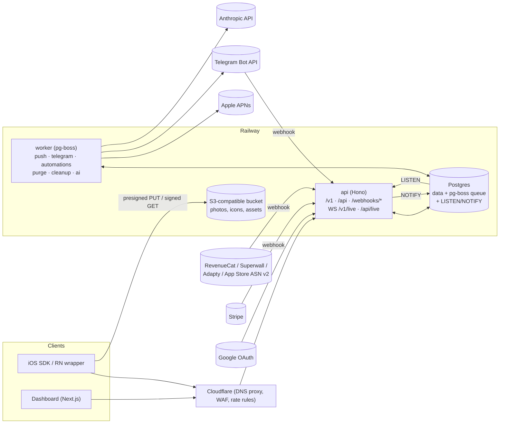

# Backend build plan

How to build the server side of a reception-style product: the API the iOS SDK talks to, the API behind the team inbox, realtime delivery, push, Telegram, subscription webhooks, automations, billing and (later) AI replies.

This plan builds on [`PRODUCT_TEARDOWN.md`](PRODUCT_TEARDOWN.md): §5 (inferred architecture and wire protocol), §6 (full data model) and §7.3 (the hard parts). It turns those into decisions, a repo layout, contracts and a phased schedule with acceptance tests.

---

## TL;DR

| | Decision |
|---|---|
| Language | **TypeScript on Node 22**, one monorepo. Zod schemas shared by the API, the dashboard and generated Swift models. |
| HTTP | **Hono** (`@hono/zod-openapi`), one API service for SDK, dashboard and webhooks. |
| Database | **Postgres 16** + **Drizzle** (schema + migrations). |
| Jobs | **pg-boss** (Postgres-backed queue). Durable delays, cron, retries, and enqueue *inside the same transaction* as the data change. |
| Realtime | Polling for MVP (as reception's own web widget does). Then WebSockets in the API process, fanned out across instances with **Postgres `LISTEN/NOTIFY`**; move to Redis pub/sub only when scale demands it. |
| Files | S3-compatible bucket (**Cloudflare R2** or **Railway Buckets**), presigned PUT with SHA-256 checksum, short-lived signed GET. |
| Auth | Dashboard: **Better Auth** with Google, cookie sessions. SDK: device secret (Keychain) exchanged for 15-min access tokens; verified users via HS256 JWT signed by the customer's server. |
| Push / Telegram / Billing | Direct APNs over HTTP/2 (`jose` for ES256). Telegram Bot API webhooks. Stripe Checkout + Billing Portal + webhooks. |
| Hosting | **Railway**: `api`, `worker`, `dashboard`, `web` services + Postgres + bucket, staging and production environments. (You have Railway and Stripe connected in this workspace; swap freely.) |
| Timeline | **MVP backend ≈ 6–7 weeks** for one experienced TypeScript developer. **Parity without AI ≈ 4 months**, ≈ 4.5 months with AI. Backend only; the SDK and dashboard UI run in parallel. |

Why one Postgres for everything at the start: messages, the job queue, realtime fan-out and rate-limit counters all live in one database you already back up. That is one fewer service to run until real load says otherwise.

---

## Status

**B0 runs on Railway staging** (project `hshelby`, environment `staging`): dashboard at `https://dashboard-staging-0dee.up.railway.app`, API at `https://api-staging-f8f8.up.railway.app`.

Where B0 differs from the plan below:

- **Sign-in is email + password.** Google comes later; it is one `socialProviders.google` block in `apps/api/src/auth.ts` plus a button.
- **Billing moved partly into B0.** Better Auth's Stripe plugin handles organization subscriptions (plan `founder`, monthly or yearly). It runs in **test mode only**: the API refuses `sk_live_` keys, and billing stays off until all four `STRIPE_*` variables are set. B5 keeps the gating middleware and the founder-spot counter.
- **Not done yet:** OpenAPI output from `contracts`, Sentry, email delivery (invitations are logged, not sent).

Railway layout:

| Service | Build / start | Notes |
|---|---|---|
| `api` | `npm run build -w @hshelby/api` / `npm run start -w @hshelby/api` | Pre-deploy `npm run migrate -w @hshelby/api`; healthcheck `/health` (runs `select 1`). |
| `worker` | same with `@hshelby/worker` | pg-boss; nightly cleanup at 03:00 UTC. |
| `dashboard` | same with `@hshelby/dashboard` | Healthcheck `/health`. Proxies `/api/*` to the API over the private network, so auth cookies are first-party. |
| `Postgres` | Railway template | |

Service settings live on the services themselves (Railway's JSON config-as-code is deprecated). Watch patterns limit redeploys to the paths each service uses.

Variables (secrets are set in Railway only, never in the repo):

| Service | Variable | Value |
|---|---|---|
| api | `DATABASE_URL` | `${{Postgres.DATABASE_URL}}` |
| api | `BETTER_AUTH_URL` | `https://${{dashboard.RAILWAY_PUBLIC_DOMAIN}}` (the browser's origin) |
| api | `BETTER_AUTH_SECRET`, `ENC_KEYS` | random; `ENC_KEYS` is `v1:<base64 32 bytes>` |
| api | `PUBLIC_API_URL` | `https://${{RAILWAY_PUBLIC_DOMAIN}}` |
| api | `STRIPE_SECRET_KEY`, `STRIPE_WEBHOOK_SECRET`, `STRIPE_PRICE_MONTHLY`, `STRIPE_PRICE_YEARLY` | Stripe sandbox values; webhook endpoint `https://<api domain>/api/auth/stripe/webhook` |
| worker | `DATABASE_URL` | `${{Postgres.DATABASE_URL}}` |
| dashboard | `API_INTERNAL_URL` | `http://${{api.RAILWAY_PRIVATE_DOMAIN}}:${{api.PORT}}`, read at build time |

---

## 1. What the backend has to do

1. **SDK API** (`/v1`): register devices, issue tokens, sync conversations, accept messages and photos, track read/unread, record card taps, accept app events, serve remote appearance.
2. **Dashboard API** (`/api`): orgs, members, invitations, apps, inbox (list, thread, reply, resolve, block), customer details, settings for push / Telegram / reviews / paywalls / automations / billing.
3. **Realtime**: new messages, typing, read state and "In chat" presence to the phone and to every open dashboard tab.
4. **Outbound work**: APNs pushes, Telegram notifications, automation steps, purges, nightly cleanup, AI replies.
5. **Inbound webhooks**: Telegram, RevenueCat, Superwall, Adapty, App Store Server Notifications v2, Stripe.
6. **Billing and gating**: one subscription per org. If it lapses, users can still write in, but the team can't reply (reception's documented behavior).

Not in this plan, but they consume it: the Swift SDK, the React Native wrapper, the dashboard UI. Section 6 is the contract they build against.

---

## 2. Architecture



**Rule of thumb:** the API does the minimum inside the request (validate → write → enqueue → NOTIFY) and the worker does anything that talks to a third party. So a slow APNs or Telegram call never slows a send, and every side effect retries on its own.

---

## 3. Repo layout

The current landing page moves to `apps/web` in phase B0.

```
apps/
  api/           Hono app: routes, auth middleware, WebSocket gateway, webhook receivers
  worker/        pg-boss consumers + cron schedules
  dashboard/     Next.js inbox (client of the API)
  web/           marketing site (today's src/)
packages/
  contracts/     Zod request/response schemas + error codes → OpenAPI → Swift models
  db/            Drizzle schema, migrations, typed query helpers
  core/          domain logic: messaging, identity, cards, automations, appearance
  integrations/  apns, telegram, stripe, storage, provider normalizers (rc/superwall/adapty/asn)
  testing/       factories, Postgres test harness, webhook fixtures
```

`core` has no HTTP in it, so the API, the worker and tests all call the same functions.

---

## 4. Data model, MVP subset

The full model is in the teardown §6. The MVP needs these tables, with the constraints that matter:

```text
organizations   id, name, stripe_customer_id, sub_status, plan, current_period_end
users           id, email, name, image                (Better Auth also owns sessions/accounts)
memberships     org_id, user_id, role{admin|member}   UNIQUE(org_id, user_id)
invitations     id, org_id, email, role, token_hash, expires_at

apps            id, org_id, public_id 'app_…' UNIQUE, name, icon_key, bundle_id, app_store_id,
                identity_secret_enc, only_verified, appearance_published_json, appearance_version
push_configs    app_id PK, team_id, key_id, p8_enc, title_template, body_template

devices         id, app_id, secret_hash UNIQUE, session_version, user_id_ext, name, email, verified,
                metadata_json, app_version, sdk_version, os_version, model, locale, timezone,
                push_token, push_env{sandbox|production}, push_issue, blocked, last_seen_at, deleted_at
                INDEX(app_id, user_id_ext)

conversations   id, app_id, device_id, status{open|closed}, last_seq bigint DEFAULT 0,
                user_read_seq, team_read_at, unread_for_user, unread_for_team,
                last_message_at, superseded_at
                UNIQUE(device_id) WHERE superseded_at IS NULL   -- one live conversation per device
                INDEX(app_id, status, last_message_at DESC)      -- the inbox query

messages        id, conversation_id, seq, sender{user|agent}, source{sdk|dashboard|telegram|automation|ai},
                author_user_id, device_id, client_id, kind{text|review|paywall}, text, card_json,
                action_clicked_at, created_at
                UNIQUE(conversation_id, seq)
                UNIQUE(device_id, client_id)                     -- idempotent retries

attachments     id, device_id|user_id, message_id NULL, object_key, content_type, bytes, width, height,
                sha256, status{pending|verified}, created_at
```

Conventions:
- Every table that holds customer data reaches `org_id` through `app_id`. Every query goes through a `scoped(orgId)` helper; no raw cross-org queries.
- Secrets (`p8_enc`, `identity_secret_enc`, Telegram tokens, provider secrets) use AES-256-GCM envelope encryption with a versioned master key from env (`ENC_KEY_V1`), so keys can rotate later.
- IDs: UUIDv7 internally (time-ordered); public prefixes (`app_`, `ids_`) only at the edge.

---

## 5. The core flows

### 5.1 Device registration and tokens

1. `POST /v1/devices` with `{appId, device details, identity?, metadata?, push?, identityToken?}`.
2. The server creates a device and returns `{deviceSecret, accessToken, expiresIn}`. `deviceSecret` is 32 random bytes, stored only as SHA-256. The SDK keeps it in the Keychain (`…ThisDeviceOnly`).
3. `accessToken` is a 15-minute HS256 token signed with a server key: `{dev, app, sv: session_version, exp}`.
4. `POST /v1/session/refresh` with the device secret issues a new access token.
5. `logout` and `DELETE /v1/device` bump `session_version`, which kills outstanding tokens.
6. **Verified users:** if `identityToken` is present, verify HS256 against the app's decrypted `ids_…` secret. `user_id` and `exp` are required, max 4,096 chars. On success, set `verified=true` and store the claims, not the token. A different `user_id` from the stored one starts a fresh device session (the teardown's mismatch rule). When `only_verified` is on, reject unverified sends with `verification_required`.

### 5.2 Sending a message (the heart of it)

Ordering and no duplicates come from one short transaction:

```sql
BEGIN;
-- 1. Lock (or create) the device's live conversation and take the next seq
UPDATE conversations
   SET last_seq = last_seq + 1, status = 'open',
       last_message_at = now(), unread_for_team = unread_for_team + 1
 WHERE device_id = $device AND superseded_at IS NULL
RETURNING id, last_seq;            -- row lock serializes concurrent sends
-- (if no row: INSERT the conversation first, then repeat)

-- 2. Insert; UNIQUE(device_id, client_id) turns a retried send into a conflict
INSERT INTO messages (conversation_id, seq, sender, source, device_id, client_id, kind, text)
VALUES ($conv, $seq, 'user', 'sdk', $device, $clientId, 'text', $text);

-- 3. Side effects ride the same transaction (outbox): never lost, never sent for a rolled-back row
--    boss.send('team.notify', {messageId}, {db: tx})   -> Telegram + dashboard counters
--    boss.send('ai.consider', {conversationId}, {db: tx, singletonKey: conv, startAfter: 8})
SELECT pg_notify('rt', json_build_object('conv', $conv, 'seq', $seq)::text);
COMMIT;
```

On a unique violation for `(device_id, client_id)`, roll back and return the stored message: the client sees success and still has exactly one copy (reception's checklist tests this explicitly). Agent replies from the dashboard, Telegram, automations and AI all go through the same `core.appendMessage()` with a different `sender`/`source`, and enqueue `push.send` instead of `team.notify`.

### 5.3 Reading, unread, sync

- `GET /v1/conversation?after=<seq>` returns the conversation plus messages after `seq` (or the latest 50). It's used for the first load, polling, and catch-up after a WebSocket reconnect.
- `POST /v1/read {seq}`: `user_read_seq = GREATEST(user_read_seq, $seq)`, then recompute `unread_for_user`.
- `GET /v1/unread` is cheap and index-only, and it's what the SDK polls when the chat is closed. Polling stops once push works (reception does the same, and it's what keeps idle installs from hammering you).

### 5.4 Photos

1. `POST /v1/uploads {contentType, bytes, width, height, checksum}`: validate JPEG/PNG, ≤ 1 MiB, ≤ 2,048 px. Create a pending attachment and return a presigned PUT carrying `x-amz-checksum-sha256` and `If-None-Match: *`.
2. The client PUTs straight to the bucket.
3. `POST /v1/messages {…, attachmentIds}`: the server HEADs each object (size and checksum match), marks it verified and links it to the message.
4. Reads use signed GET URLs that live 15 minutes. A nightly `cleanup` job deletes pending uploads older than 24h.

### 5.5 Realtime (phase B6)

- `GET /v1/live` (SDK) and `GET /api/live` (dashboard) upgrade to WebSocket and authenticate with the access token or the session cookie.
- Every API instance runs one `LISTEN rt`. On each notification it forwards `{type:'message.created', conv, seq}` to sockets subscribed to that conversation or app. Clients fetch with `after=seq`, so NOTIFY payloads stay tiny (well under Postgres's 8 KB limit).
- Typing: client → server → peers, never stored.
- Presence: the SDK sends a heartbeat every 15 s while the chat is visible. The server writes `last_seen_in_chat_at` at most once a minute. "In chat" means seen in the last 45 s.
- **Skip push** for an agent reply when the device is "In chat". That saves APNs calls and stops the double ping.
- When one Postgres connection per instance becomes a limit (dozens of instances), switch fan-out to Redis pub/sub. Only `realtime/fanout.ts` changes.

### 5.6 Push (`push.send` job)

- Per app: encrypted `.p8`, Key ID, Team ID. Provider JWT (ES256 via `jose`), cached about 50 min per (team, key).
- `node:http2` sessions to `api.push.apple.com` / `api.sandbox.push.apple.com`, chosen by the **device's** `push_env`. Headers: `apns-topic = bundle_id`, `apns-push-type: alert`. Body: templated title and body, `thread-id = conversationId`, a custom key for the conversation, and `badge = unread_for_user` when the device opted in.
- Responses:

  | Response | Action |
  |---|---|
  | `410 Unregistered` | clear the token |
  | `400 BadDeviceToken` / `DeviceTokenNotForTopic` | store as the device's push issue (shown in the dashboard) |
  | `403 InvalidProviderToken` | flag the app's push config |
  | `429` / `5xx` | retry with backoff |

- Job `singletonKey = messageId`, so one push per message even under retries.

### 5.7 Telegram

- The customer pastes their own bot token (from BotFather). The server calls `setWebhook` with `secret_token` and checks it on every update (`X-Telegram-Bot-Api-Secret-Token`).
- **Outbound** (`team.notify`): `sendMessage` to the linked group, then store `telegram_posts(chat_id, message_id → conversation_id)`.
- **Inbound:** a reply → `reply_to_message.message_id` → conversation → `core.appendMessage(source='telegram')` → 👍 reaction via `setMessageReaction`.
- Handle `migrate_to_chat_id` (a group upgraded to a supergroup). Throttle to about 20 messages/min per group with a per-chat pg-boss throttle.

### 5.8 Subscription webhooks → automations (phase B10)

1. Verify each provider:

   | Provider | Check |
   |---|---|
   | RevenueCat | auth header |
   | Superwall | `whsec_` HMAC |
   | Adapty | auth header + URL check |
   | App Store ASN v2 | JWS x5c chain to the Apple root + `bundleId` |

2. `INSERT provider_events … ON CONFLICT (provider, provider_event_id) DO NOTHING`. Providers retry, so this keeps processing idempotent.
3. Normalize to canonical events (trial_started, trial_converted, renewed, cancelled, expired, billing_issue, refunded…).
4. Match devices by user ID, sticky provider IDs, or `originalTransactionId`. Update plan and status metadata.
5. `automation.evaluate` creates `automation_runs`. Each step is a pg-boss job with `startAfter`, computed in the device's time zone for "tomorrow at 10:00" waits. Every step re-checks enablement, the audience rules and the 24h ongoing-conversation suppression, and holds the run if an offer or rating can't be sent.

### 5.9 Billing

- Stripe Checkout (subscription mode, monthly and yearly prices) plus the Billing Portal.
- Webhooks `checkout.session.completed`, `customer.subscription.updated|deleted` and `invoice.payment_failed` → `organizations.sub_status`.
- A `requireActiveSubscription` middleware guards team-side writes (reply, cards, new apps, invites). SDK writes from end users are **never** gated.

---

## 6. API contract (what the SDK and dashboard build against)

All bodies are Zod-validated. Errors use `{error: {code, message}}` with stable codes (`verification_required`, `identity_changed`, `upload_incomplete`, `device_blocked`, `subscription_inactive`, …). OpenAPI is generated from `packages/contracts`, and Swift `Codable` models are generated from the OpenAPI.

**SDK `/v1`** (Bearer access token unless noted)

| Method & path | Purpose |
|---|---|
| `GET /v1/apps/:appId/appearance` | Public remote appearance, cacheable (no auth) |
| `POST /v1/devices` | Register; returns device secret + access token (App ID auth) |
| `POST /v1/session/refresh` | Device secret → new access token |
| `PATCH /v1/device` | Update details, identity, metadata, push token, available paywalls |
| `GET /v1/conversation?after=` | Sync / poll / catch-up |
| `POST /v1/messages` | Send `{clientId, text, attachmentIds}` |
| `POST /v1/uploads` | Presign a photo upload |
| `POST /v1/read` | Advance read cursor `{seq}` |
| `GET /v1/unread` | Unread count for badges |
| `POST /v1/actions/:messageId/click` | Card tap receipt (first tap wins) |
| `POST /v1/track` | App event `{event}` → `{sent, openChat}` |
| `POST /v1/session/logout` · `DELETE /v1/device` | Logout / delete data |
| `GET /v1/live` (WS) | Live stream while the chat is open (phase B6) |

**Dashboard `/api`** (session cookie, org-scoped): `orgs`, `members`, `invitations`, `apps` (+ secrets reveal/rotate), `conversations` (list with `status`/`app`/search, cursor pagination), `conversations/:id/messages` (reply, review card, offer card), `conversations/:id/{resolve,reopen}`, `devices/:id` (details, block, reset), `push-config`, `telegram`, `providers`, `automations`, `billing/{checkout,portal}`, `GET /api/live` (WS).

**Webhooks:** `/webhooks/telegram/:connectionId`, `/webhooks/revenuecat/:appId`, `/webhooks/superwall/:appId`, `/webhooks/adapty/:appId`, `/webhooks/appstore/:appId`, `/webhooks/stripe`.

---

## 7. Jobs and schedules

| Job | Trigger | Idempotency | Retry |
|---|---|---|---|
| `push.send` | agent message to a device not "In chat" | `singletonKey = messageId` | 5× exponential, then mark push issue |
| `team.notify` | user message | `singletonKey = messageId` | 5× |
| `telegram.send` | from `team.notify` | per-chat throttle | respects `retry_after` |
| `ai.consider` | user message (debounced ~8 s) | `singletonKey = conversationId` | 2× |
| `automation.evaluate` / `automation.step` | app event, provider event / scheduled | run id + step index | 3× |
| `purge.scope` | delete device/app/org | scope id | until success, alert after 10 |
| `cleanup.nightly` | cron 03:00 UTC | n/a | daily |
| `billing.sync` | Stripe webhook backstop | org id | 3× |

---

## 8. Security checklist

- [ ] Org scoping enforced in `core` (and covered by a test that tries to read another org's conversation through every dashboard route).
- [ ] All secrets encrypted at rest. Revealed in the dashboard only to admins, and every reveal or rotation is logged.
- [ ] Device secrets and invitation tokens stored hashed. Access tokens short-lived and revocable through `session_version`.
- [ ] Webhook signatures verified before parsing anything else. Raw bodies kept for HMAC checks.
- [ ] Rate limits per device, per app and per hashed IP (start in Postgres or in-process; Cloudflare rules in front).
- [ ] Upload type/size/dimension checks server-side, checksum verified, signed GETs only.
- [ ] No message bodies in logs (log IDs). PII deletion paths tested end to end.
- [ ] Backups: daily Postgres snapshots plus a monthly restore drill.

---

## 9. Phased schedule (backend only, one developer)

Each phase ends with acceptance tests that must pass in CI and on staging.

| Phase | Scope | Done when | Effort |
|---|---|---|---|
| **B0 Foundations** (done, see Status) | Monorepo, move landing page to `apps/web`, Postgres + Drizzle migrations, Hono skeleton with error envelope, `contracts` → OpenAPI, Better Auth (Google), orgs/members/invitations/apps CRUD, encryption util, pino logs + Sentry, Railway staging deploy with migrate-on-deploy, CI | A teammate signs in with Google, creates an org and an app, and sees its `app_…` ID on staging | 1 wk |
| **B1 Messaging core** | Device register/refresh, conversation sync, send with seq + idempotency, read/unread, inbox list/thread/reply/resolve/block | A script acting as the SDK sends 200 concurrent messages with 20% retried `clientId`s → exactly 200 rows, seq 1–200 with no gaps; a dashboard reply shows up on the next poll | 2 wks |
| **B2 Photos** | Presign, verify, signed GET, nightly cleanup | A wrong checksum is rejected; a pending upload disappears after 24h in a time-travel test | 0.5–1 wk |
| **B3 Push** | `.p8` upload, `push.send`, env per device, templates, badge, issue capture, "send test" | Real device gets a push in sandbox and production builds; a revoked token clears itself | 1 wk |
| **B4 Identity & deletion** | `identify` labels, metadata limits, JWT verification, only-verified mode, logout/delete + `purge.scope` | JWT test vectors from the docs pass; a deleted device's rows and objects are gone | 1 wk |
| **B5 Billing** | Stripe Checkout/Portal/webhooks, gating middleware, founder-spot counter | Test-mode subscription toggles reply access; users can still send while lapsed | 0.5–1 wk |
| **MVP backend** | | | **≈ 6–7 wks** |
| **B6 Realtime** | WS gateway, LISTEN/NOTIFY fan-out, typing, presence, skip-push-when-in-chat | Two API instances: a reply sent via instance A reaches a socket on B in < 300 ms | 1–1.5 wks |
| **B7 Cards** | Review + offer cards, paywall registry from device reports, click receipts, stats | An offer card for an unreported paywall is refused; the first tap is recorded once | 1 wk |
| **B8 Telegram** | Connect bot, notify, reply mapping, reactions, supergroup migration, throttle | Replying in Telegram lands in the app chat; 50 bursts respect the per-chat limit | 1.5 wks |
| **B9 Appearance & assets** | Draft/publish remote appearance, asset library (PNG ≤ 512 px), team photos | SDK fetches the published version; drafts never leak | 1 wk |
| **B10 Subscriptions + automations** | Four provider receivers, normalization, matching, automation builder API, run engine with waits, suppression, holds, results | Replaying each provider's fixture set yields the expected canonical events; a "cancelled → offer tomorrow 10:00 local" run fires at the right UTC time across 3 time zones | 3 wks |
| **B11 AI replies** | See §11 | Eval set passes the bar you set; handover never double-replies | 2–3 wks |
| **B12 Hardening** | Load test, Redis if needed, audit log, restore drill | 1,000 polling devices + 50 msgs/s holds p95 < 150 ms on staging | 1 wk |

**Totals:** MVP backend ≈ 6–7 weeks; parity without AI ≈ 4 months; with AI ≈ 4.5 months. These are backend-only numbers; the full-product estimates in the teardown (§7.2) add the SDK, React Native wrapper and dashboard UI.

### Week 1, day by day
1. Turborepo + npm workspaces; move `src/` into `apps/web`; CI (lint, typecheck, test).
2. `packages/db` with organizations/users/memberships/apps; first migration; Railway Postgres (staging).
3. `apps/api` Hono skeleton, error envelope, request IDs, health check; Better Auth with Google.
4. Org, member, invite and app routes with the `scoped(orgId)` helper and the cross-org test.
5. Encryption util + `ids_` secret generation; OpenAPI output from `contracts`; deploy to staging.

---

## 10. Testing and operations

- **Tests:** Vitest. Integration tests run against a real Postgres (Docker locally, a disposable database in CI); no mocking the database.
- **Concurrency tests** for seq/idempotency; **fixture tests** for every webhook provider (payloads copied from their docs); **contract tests** that the OpenAPI matches the routes.
- **Environments:** Railway `staging` and `production`, plus PR environments for the API. Migrations run as a pre-deploy step; every migration has to work alongside the previous app version (expand → migrate → contract).
- **Observability:** pino JSON logs, Sentry for errors, and three dashboards from day one: API latency, pg-boss queue depth and failures, push/Telegram error rates.
- **Backups:** Railway Postgres backups plus a monthly restore into staging.

---

## 11. AI replies (phase B11)

Reception markets this but its legal docs say it isn't live yet, so it's a chance to ship it first.

- **Model:** Claude Opus 5.5 (`claude-opus-5-5`) through `@anthropic-ai/sdk`. Thinking can't be turned off on this model; control cost and latency with `output_config: { effort: "low" }` (or `"medium"`, the default) for chat replies. Pricing at the time of writing: $4 / $20 per million input / output tokens, cached reads $0.20. Evaluate a cheaper model later if the bill matters; that's a measured trade-off, not a default.
- **Knowledge without a vector database at first.** A typical indie app's help docs are small. Put the app's docs in the system prompt and mark them with prompt caching, so every reply re-reads them at the cached rate. Only once docs outgrow that (hundreds of thousands of tokens) add retrieval: pgvector in the same Postgres plus an embeddings provider. Anthropic doesn't offer an embeddings model; Voyage AI is the usual pairing.
- **Tools** via the SDK's tool runner (`client.beta.messages.toolRunner` with `betaZodTool`, reusing the Zod contracts): `reply(text)`, `send_offer(paywallId, text)`, `ask_review(text)`, `handover(reason)`. Mark them `strict: true` and use `tool_choice: auto`; forced tool choice returns a 400 on this model.
- **Guardrails live in the tool code, not the prompt.** `send_offer` only accepts paywalls the device reported as available; `ask_review` respects the repeat guard; nothing can promise refunds. If a human replies, cancel the pending `ai.consider` job and pause the AI on that conversation until handed back.
- **Refusals:** enable server-side fallbacks (`fallbacks: "default"` with beta `server-side-fallback-2026-07-01`). If the final `stop_reason` is still `refusal`, hand over to a human.
- **Debounce:** wait about 8 s after the last user message so three quick messages get one answer.
- **Before turning it on per app:** an eval set built from real resolved conversations, and adding Anthropic to your DPA's subprocessor list.

---

## 12. Risks

| Risk | Mitigation |
|---|---|
| Duplicate or out-of-order messages on flaky networks | `UNIQUE(device_id, client_id)`, row-locked seq, `after=seq` catch-up, concurrency test in CI |
| Polling cost from idle installs | `/v1/unread` is index-only; back off when the chat is closed; stop polling once push works |
| APNs environment mistakes | `push_env` stored per device from the SDK; "send test" button; surface push issues in the dashboard |
| Webhook replays and ordering | Event-ID uniqueness; handlers are idempotent; state derives from the latest provider timestamp |
| Long automation waits lost on deploy | Waits are pg-boss jobs in Postgres, not timers in memory |
| Single Postgres as a bottleneck | Plenty for the first thousands of apps; the escape hatches (Redis fan-out, read replica, partitioning `messages` by month) are isolated |

---

## 13. Decisions to make before B0

1. **Hosting:** Railway (assumed above) or Cloudflare-first (Workers + Durable Objects, as the teardown suggests)? Railway is simpler to run; Cloudflare scales sockets more cheaply.
2. **Team shape:** if one person does backend and SDK, interleave B1 with the SDK's first chat screen so the contract gets exercised early.
3. **AI in v1 or later?** Shipping it first is a differentiator; it adds about 2–3 weeks.
4. **Data residency:** EU customers will ask. Pick the Railway region (and bucket region) before launch.
