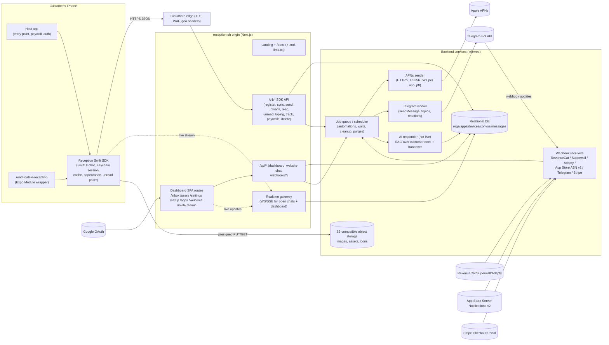

# reception.sh: product and architecture teardown

Prepared 2026-10-27 from a static snapshot of reception.sh (no live probing). Goal: understand the product well enough to build it.

> **Note on sources.** The citation keys below refer to files from the 2026-10-27 Firecrawl/curl scrape (`llms-full.txt`, crawled pages, JS/CSS bundles). Those raw files are reception's own content and are not committed to this repo; re-run the scrape described in `SITE_SPEC.md` to regenerate them.

**Sources and citation keys**

| Key | Source |
|---|---|
| `docs: <Section>` | `x_llms-full.txt`, the complete docs site as Markdown (25 pages) |
| `site: home` | Landing page (`pages/home.md`, `raw.html`, screenshots) |
| `site: changelog` | `pages/changelog.md` (SDK 1.0.0 to 1.5.0) |
| `legal: Privacy` / `legal: Terms` / `legal: DPA` | `pages/privacy_policy.md`, `terms.md`, `dpa.md` (all dated 18 Oct 2026, described by the docs as "still drafts") |
| `robots` | `x_robots.txt` |
| `js: website-chat` | Minified Next.js chunk `js/10n_lr1v_zgth.js`, the client of Reception's *own* website support widget, which uses the same message model |
| `css` | `main.css` custom properties |

**Labels.** Unlabelled statements are facts from the cited source. **[Inference]** marks my reasoning. **[Observed]** marks something read directly from shipped JS or CSS but not documented.

---

## TL;DR

- Reception is a **native SwiftUI support chat SDK for iOS 17+**, with a React Native/Expo wrapper around the same Swift code, plus a hosted multi-app team inbox. It is built by two indie developers ("by appmaxxers for appmaxxers") and sold at a **flat $25/mo per organization**, with no seat pricing. `docs: Pricing & billing`, `site: home`
- The pitch is **revenue, not tickets**. Chat is the delivery channel for **paywall/offer cards**, **App Store review cards** and **automations** triggered by app events such as a closed paywall or a cancelled purchase, and by subscription webhooks from RevenueCat, Superwall, Adapty or the App Store. `docs: Paywall cards`, `docs: Automations`, `docs: Subscription providers`
- **Identity is scoped to the device, not the user.** Each install registers with a public `app_…` App ID and gets a session stored in the Keychain. `identify()` attaches unverified labels. Verified identity is an **HS256 JWT signed by the customer's server with a per-app `ids_…` secret**. Histories never merge across devices. `docs: Users & accounts`
- **Cards are thin server objects; the app holds the logic.** A review card is an agent message whose App Store URL is derived from the saved App Store ID. A paywall card carries a paywall ID that the device has already reported as available. The **app** decides availability and opens its own paywall through `onPaywall(id)`. Reception records only the tap. `docs: Paywall cards`, `docs: Review requests`
- **Push is direct APNs** using the customer's uploaded `.p8` key, with the environment detected per device from the embedded provisioning profile. The payload marker is `reception.conversationId`. `docs: Push notifications`
- **Telegram** is a full reply channel. Reply to the bot's notification, or write in a per-customer Forum Topic, and the text lands in the in-app chat. `docs: Telegram`
- **The "AI agent" is marketed but not live.** The landing page promises answers from your docs with human handover. The docs mention "AI replies" in passing. The Privacy Policy and DPA say AI processing "is not an active data flow". `site: home`, `legal: Privacy §4`, `legal: DPA Sched. C`
- **Onboarding is the moat.** A 142-line "setup prompt" pasted into Claude Code, Codex or Cursor does the whole integration, including a design round from simulator screenshots and a self-test through the `-ReceptionSetupCheck` launch argument and `os_log` polling. The docs ship `llms.txt` and `llms-full.txt` and `.md` versions of every page. `docs: Get started`
- **Stack (observed or inferred):** a Next.js (App Router, Turbopack) web app and docs, Tailwind v4, shadcn/Radix, Zod v4, Cloudflare at the edge, Google OAuth, Stripe Managed Payments as merchant of record, S3-compatible object storage with presigned PUTs, APNs token auth and the Telegram Bot API. The DB and host are unnamed. The SDK has zero dependencies and is built with Swift 6 tools.

---

## 1. What it is

### 1.1 One-paragraph pitch

Reception gives an iOS app a **native, themeable in-app support chat**: SwiftUI, Liquid Glass on iOS 26, 48 languages, photos, typing indicators and read receipts. It is paired with a **hosted inbox** where an indie team answers every app in one place, in the browser or **from Telegram**. On top of the chat it adds **monetization and retention actions**: agents, automations and (promised) AI can send a **paywall card** that opens the app's own purchase screen, or a **review card** that deep-links to the App Store write-review page. **Automations** fire from app events (`paywall_declined`, `checkout_cancelled`) or from subscription lifecycle webhooks (`trial_cancelled`, `billing_issue`). The tagline is "agentic in app support. Lower churn. Increase conversion, lower churn, get more reviews." `site: home`, `docs: Overview`

### 1.2 Company and stage

- The operator is **Frederick James Dev Ltd**, England and Wales. The founders are **Andi and Frederick** ("hey we're frederick and andi"). `legal: Terms §1`, `site: home`
- SDK **1.0.0 shipped 1 Oct 2026**, and **1.5.0 (Automations) shipped 23 Oct 2026**. The docs already describe SDK 1.6 (registration at launch) and 1.7 (App Store transaction IDs), so the docs run ahead of the public changelog. `site: changelog`, `docs: Subscription providers`
- Social proof on the landing page: "39 apps use reception", "2,456 issues resolved", "563 extra reviews", "$7.9k additional revenue". The showcase apps are small consumer apps (Clucky, 75 Days Her Challenge, Aesty, StepKey, Acadeller, Loomi, Ekto, Superlife, Marker, Grove). `site: home`
- Roadmap hints: "via in app support, **and soon imessage**" (`site: home`), a `--imessage-gray` token (`css`), and "The website chat has no automations" (`docs: Automations`), which hints at a web chat surface.

### 1.3 Target customer

- **Indie and small-team iOS subscription-app developers**, the "appmaxxers": apps with paywalls (RevenueCat, Superwall or Adapty), a solo dev or 2–3 people, and replies sent from a phone ("reply from the beach or the gym"). `site: home`
- They are also people who build with **coding agents**. The integration path assumes Claude Code, Codex or Cursor. `docs: Get started`
- Who it is not for: the enterprise threshold is **over $30k/month app revenue or over 10k MAU**, combined across the organization's apps. `docs: Pricing & billing`

### 1.4 Positioning vs Intercom, Crisp and Zendesk (analysis)

| Dimension | Reception | Intercom / Zendesk / Crisp |
|---|---|---|
| Client UI | **Pure SwiftUI**, inherits app colors and font; no webview | Mostly web-based messengers in mobile SDKs, generic look |
| Platforms | iOS only (Android and web calls are no-ops) | Web, iOS, Android, email, social |
| Pricing | **Flat $25/mo per org**, all apps, all seats | Per seat plus per resolution (AI); usage tiers |
| Core job | **Retention and monetization**: offer cards, review asks, paywall-close automations, subscription-event triggers | Ticketing, help center, SLAs, CSAT, routing |
| Team inbox | One inbox across apps, plus **Telegram replies** | Full helpdesk, macros, assignment, SLA |
| Setup | **One coding-agent prompt**, about 10 minutes | Manual SDK setup plus admin configuration |
| Identity | Device-scoped sessions; optional JWT verification | User-scoped contacts with merging; HMAC/JWT verification |
| Missing (by design or not yet) | Email channel, help center, assignment, macros, tags, CSAT, Android, web SDK | – |

**[Inference]** The wedge is "support as a revenue surface for subscription apps". Integrating RevenueCat, Superwall and Adapty paywalls into chat, and turning their webhooks into triggers, is the differentiator. Native look and flat pricing remove the usual objections from indie developers.

### 1.5 Pricing model

- **$25/month or $200/year per organization**, plus tax or VAT. One subscription covers every app and every member. `docs: Pricing & billing`, `legal: Terms §5`
- **Founder pricing:** the landing page shows "**41/50 spots claimed. Next price: $50/m**". The value is server-rendered into the RSC payload, so it is probably computed from a live subscriber count. `site: home` **[Inference]** The price steps to $50/mo after 50 organizations. Existing subscribers presumably keep $25 (not stated).
- **Enterprise:** over $30,000/month combined revenue or over 10,000 MAU means "email hello@reception.sh for a quote". `docs: Pricing & billing`
- **Billing mechanics:** subscribing is the **last onboarding step**, done through Stripe Checkout. **Stripe is merchant of record (Managed Payments)**, and card statements show `LINK.COM* RECEPTION`. Management happens in the Stripe billing portal. Switching to yearly applies immediately with credit; switching to monthly applies at the end of the year. Cancellation runs to the end of the period with no refunds. `docs: Pricing & billing`
- **Gating:** before subscribing, you can reply only to **your own test device during setup**. Inbox, Users, AI replies, paywall and review cards, extra apps and invitations require an active subscription. **End users can always send**, and nothing is lost while a subscription lapses. `docs: Pricing & billing`, `legal: Terms §5`

---

## 2. Feature inventory (with mechanics)

### 2.1 In-app chat

| Capability | Mechanics | Source |
|---|---|---|
| Composer | Multiline. Text is trimmed and whitespace-only is rejected. **Max 4,000 characters** (some emoji count as 2). Over-limit drafts are blocked, not truncated. Plain text only: no Markdown/HTML rendering, editing or deletion. | `docs: Chat features` |
| Photos | System Photos picker, images only. **Up to 5 per message**. Converted to **JPEG at most 2,048 px on the long edge and at most 1 MiB**; transparency becomes white. No camera, files, video or audio. Full-screen viewer with pinch and double-tap zoom. | `docs: Chat features`, `docs: Privacy and data` |
| Sending states | The local bubble appears immediately, then "Sending", then **Sent** (server accepted), or **Not delivered** with Retry. Some waits show an automatic resend countdown with Cancel. "Sent" does not mean an agent read it. | `docs: Chat features` |
| Typing | The SDK shows agent typing and reports customer typing to the dashboard while the conversation is open. | `docs: Chat features` |
| Read state | When a visible chat is active, loaded messages are **reported read automatically** at conversation level (no viewport tracking). Agents see Sent, **Delivered** (client fetched through that message) and **Read** (gray double tick). | `docs: Chat features`, `docs: Inbox & customers` |
| History | Initial load returns the **latest 50 messages**. There is no "load older" control or pagination API in the SDK. The dashboard does scroll back. | `docs: Chat features` |
| Live updates | Live while the chat is visible and the app is active. Paused in the background and on dismiss. A "live chat connection" drives the dashboard's **In chat** signal. 1.4.1 fixed the connection giving up "after eight drops". | `docs: Chat features`, `site: changelog` |
| Connection banner | No connection / Connecting / Connected / **Live updates paused**, the last being a server-side throttle with a waiting notice. | `docs: Chat features` |
| Offline and cache | Recent history and pending or failed messages, with their photos, are persisted. Text drafts are persisted separately. Unsent photo selections are memory-only. The history cache is **excluded from backups**. | `docs: Chat features`, `docs: Privacy and data` |
| Retries | Automatic retries while visible and active. Manual Retry otherwise. No background delivery guarantee. **[Observed]** Sends carry a client-generated `clientId` for idempotency (`js: website-chat`). | `docs: SDK reference#retries` |
| Blocking | A blocked device can still read history; the composer is replaced by a sending-disabled notice. The team can still reply. | `docs: Chat features` |
| Rate limits | "Reception may temporarily limit frequent sends or photo uploads." A photo-only restriction can still allow text. Limits are keyed by device, app and **hashed IP**. | `docs: Chat features`, `legal: DPA Sched. B` |
| Resolve and reopen | Resolving leaves the iOS chat untouched. The **next customer message reopens the same conversation**. | `docs: Chat features` |
| Server reset | An admin "Reset support" or deleted device makes the SDK wipe local state on its next contact; the next send starts fresh. | `docs: Chat features` |

### 2.2 Entry point and launcher

- **The SDK has no built-in launcher.** "The SDK has no public ready-made settings row or floating entry button." The host builds the entry and calls `Reception.shared.openChat()`, which presents an SDK-owned sheet, or embeds `ReceptionChatView()` in its own sheet, navigation stack or tab. `docs: Open & close the chat`
- The docs ship copy-paste SwiftUI examples: settings row, Liquid Glass home card, floating capsule button, round icon button and dedicated Support tab. Each example shows a red capsule badge only when `unreadCount > 0`. `docs: Open & close the chat`
- Dismissal: swipe, the optional close button (`showsCloseButton`, `closeIcon` of `.xmark`/`.chevronDown`/`.arrowDown`, or a custom `closeImage`), or `closeChat()`. A host-owned view is dismissed by the host. `docs: Open & close the chat`
- `openChat()` during a cold start defers until the app is active, and it is a no-op if the chat is already visible. `docs: SDK reference#open-chat`
- **[Observed]** Reception's own website has a floating launcher with an unread count, a proactive "founder greeting" bubble (Andi or Frederick at random), a Chat/Feedback menu for signed-in users and a feature-suggestion voting board. `js: website-chat`

### 2.3 Unread counts and badges

- `Reception.shared.unreadCount` is an `@Observable`, read-only `Int` for the **current device's latest conversation**. It starts at 0 and only server sync changes it. `docs: Unread messages`
- Refresh triggers:
  - SDK 1.6+: launch and foreground after registration.
  - Chat close.
  - A forwarded support push.
  - A push-token update.
  - **Periodic polling while the app is active and chat is hidden**, which "can pause for older conversations" and **pauses entirely when push is configured and permission granted**.
  - There are no checks for unused or resolved conversations, and none in the background.

  `docs: Unread messages#refresh-timing`
- Unread requests "fetch the count without loading messages or advancing delivered/read receipts". **[Inference]** There is a cheap `GET /unread`-style endpoint. The website widget uses exactly that, polling every 15 s while closed and every 3 s while open, only when the tab is visible and focused. `js: website-chat`
- **App icon badge:** `updatesAppBadge = true` (default) writes the count to the icon on every sync. At zero it **removes delivered notifications whose `userInfo` contains a `reception` key**. Setting `false` is synced to the server, which then **omits `aps.badge` from pushes**. `docs: Unread messages`

### 2.4 Identity: anonymous, labelled and verified

**Anonymous by default.** No sign-in is needed. The dashboard shows "User #…". Each **device registration** has its own history, and the same user ID on two devices **does not merge**. `docs: Overview`, `docs: Users & accounts`

**Labels:** `identify(userId:name:email:)`.
- Limits: userId up to 255, name up to 200, email up to 254 characters. Over-limit values are dropped locally.
- `nil` means "omit, keep the server value". It does not clear the field.
- Calling with no userId and just a name is the recommended pattern for apps without accounts.
- Values are **staged locally** and travel with the next registration or device update.
- They are unverified, because "anyone with your public App ID could send" them. The dashboard marks them **Unverified**.

`docs: Users & accounts`

**Verified users: the exact mechanism.** `docs: Users & accounts#verified-users`
1. Every app has an **identity secret** `ids_…`. An Admin reveals it in *Settings → app → Identity Verification*. It is stored encrypted server-side (`legal: Privacy §9`).
2. The customer's backend exposes an **authenticated** endpoint, e.g. `GET /me/reception-token`. The user must come from the session, never from the request. The endpoint signs a **JWT, HS256, using the secret string verbatim as the key** ("including `ids_`; don't decode it").
3. Claims:
   - `user_id`: required. A string up to 255 characters, or an integer up to 2^53−1.
   - `exp`: required; 7 days is recommended.
   - `email`: optional, up to 254 characters.
   - `name`: optional, up to 200 characters.
   - Other claims are ignored. `nbf` in the future is rejected. The token may be at most 4,096 characters.
   - Common mistakes: using `sub` instead of `user_id`, or omitting `exp`.
4. The app calls `Reception.shared.identify(token:)` after sign-in and **on every launch**. The token is **held in memory only** and sent with the next request (launch, foreground, chat open or first message).
5. The SDK **decodes `user_id` locally without verifying it**. If it differs from the current chat's user, the SDK immediately logs out the old session (`identity_mismatch` server-side) and the next send starts a new chat. The SDK silently ignores tokens it cannot parse, tokens over 4,096 characters and anything that looks like an `ids_` secret.
6. The server verifies the signature. On success the **chat record stores the accepted claims**, not the token, and shows an orange "verified" seal. A verified chat shows exactly the latest token's claims. After verification, `identify(userId:…)` can no longer change identity.
7. Rejections emit `ReceptionEvent.identityRejected(ReceptionError)` with `identity_token_invalid`, `identity_token_expired` (refetch the token) or `identity_not_configured`. Rejections never remove existing verification.
8. **"Only verified users can chat"** toggle: unverified sessions can read but not send. The SDK shows "Sign in to send messages.", and the server code is `verification_required`.
9. **Rotation:** "Regenerate secret" invalidates old tokens immediately. The optional "Also mark existing users as unverified" covers leaks. The secret cannot be removed.

Ready-made server snippets are provided for Firebase Functions, Supabase Edge Functions, Cloudflare Workers, Node (`jsonwebtoken` and `jose`), Python, PHP, Ruby and Go. `docs: Users & accounts#create-token`

### 2.5 Metadata and customer details

- `setMetadata([String: String])` **replaces the whole dictionary**. Limits: at most 20 entries, keys 1–64 characters, values up to 512 characters. **More than 20 entries clears everything.** `[:]` clears on the next sync. Strings only. `docs: Users & accounts#setmetadata`
- **Reserved keys:**
  - `revenuecat_id`, `superwall_id` and `adapty_id` route subscription webhooks. They are **sticky**: the server keeps the last value even if a later update omits the key.
  - `subscription_status: "active"` marks the person as paying for automations and purchase metrics.

  `docs: Users & accounts`, `docs: Subscription providers`
- **Derived dashboard fields** use the first non-empty key in a fixed order:
  - Plan: `plan`, `subscriptionPlan` or `subscription_plan`.
  - Total revenue: `totalRevenue`, `total_revenue`, `lifetimeRevenue` or `lifetime_revenue`.
  - Provider: `provider`, `subscriptionProvider` or `subscription_provider`.

  `docs: Inbox & customers`
- Automatically collected: app version, build and bundle ID; SDK and iOS versions; device model; locale; time zone; app language; badge preference; push token and environment; local appearance settings (SDK 1.3+). `docs: Privacy and data`
- The setup prompt tells the agent to **skip fields Reception already shows** and **never propose health data, passwords, precise location or payment details**. `docs: Get started#setup-prompt`

### 2.6 Push notifications

- **The developer uploads** a **`.p8` APNs auth key** (at most 16 KB, stored encrypted), its **Key ID** and **Team ID** (10 characters each) and the **Bundle ID** (used as the APNs topic). There is **one key per app** and no environment selector. Create the key as "Sandbox & Production". `docs: Push notifications#dashboard-apns`
- **App side:**
  - Add the Push Notifications capability (`aps-environment` entitlement). No Background Modes are needed because these are alert pushes.
  - The **SDK never prompts for permission.** `registerForPushIfAuthorized()` registers only if the status is authorized, provisional or ephemeral. Call it at launch, on foreground, after the app's own permission flow, and after logout or delete.
  - Forward the token through `setPushToken(Data, environment: .automatic)`.
  - Forward notifications through `handlePushNotification(userInfo:openChat:)`.
  - Delegate methods **must stay on the main actor**. A `nonisolated` async delegate crashes on tap.

  `docs: Push notifications`
- **Environment detection** (`.automatic`): sandbox on the simulator. On a device it reads `aps-environment` from the **embedded provisioning profile**: `development` means sandbox, `production` means production, and no profile means production (App Store). An unreadable profile means the token is ignored. `docs: Push notifications`
- **Payload:**
  ```json
  {"aps":{"alert":{"title":"…","body":"…"},"badge":1,"sound":"default","thread-id":"<conversationId>"},
   "reception":{"conversationId":"<conversationId>"}}
  ```
  `badge` is the conversation's unread-for-user count and is omitted if the host owns the badge. `docs: Push notifications#payload-shape`
- **Content settings** (per app, per language):
  - Title and Message templates, at most 120 characters each, with `{message}`, `{agent}` and `{app}`.
  - Rendered title capped at 100 characters, body at 500.
  - A global Sender name of up to 60 characters.
  - **Show message**: off replaces the preview with a generic prompt.
  - **Sound** toggle.
  - The language is the device's last reported app language.

  `docs: Push notifications`
- **Diagnostics:** "Send test" targets up to 10 eligible devices ordered by recent chat activity and shows Sandbox or Production. Each device stores a **Push issue** (the last APNs rejection reason). `docs: Push notifications`
- **Offer pushes:** every offer card pushes, whoever sends it (teammate, AI or automation), and there is no switch. Apple guideline 4.5.4 requires promotional-push consent and an opt-out, which is the host's job. `docs: Push notifications#offer-pushes`
- React Native: `react-native-reception/expo-notifications` provides `startReceptionPush()`, `refreshReceptionPush()` and `receptionNotificationBehavior()`. Reception sends raw APNs **without `gcm.message_id`**, so Firebase handlers don't see it. `docs: React Native#push`

### 2.7 Events and callbacks

`Reception.shared.onEvent: ((ReceptionEvent) -> Void)?` is a single handler, called on the main actor with no replay. It has seven cases: `chatOpened`, `messageSent`, `imageSent` (once per send that had images), `reviewOpened`, `paywallOpened`, `dataDeleted` and `identityRejected(ReceptionError)`. There is deliberately **no** chatClosed, incoming-message or send-failure event; observe `isChatOpen` instead. Events carry no PII. `docs: Events`

### 2.8 Appearance (local, in code)

There are 23 options on `Reception.Appearance`:
- Colors: `accentColor`, `onAccentColor`, `chatBackground`, `incomingBackground`, `incomingForeground`, `welcomeIconColor`.
- `preferredColorScheme`.
- Text: `title`, `welcomeTitle`, `welcomeText`.
- Hiding: `hidesTitle`, `hidesWelcomeTitle`, `hidesWelcomeText`.
- Welcome icon: `welcomeIcon` (SF Symbol, `Image` or `.hidden`), `welcomeIconSize`, `welcomeIconCornerRadius`, `welcomeIconOffset`.
- Fonts: `fontDesign`, `fontFamily` (a registered PostScript name).
- Close button: `showsCloseButton`, `closeIcon`, `closeImage`.
- `fadesOlderMessages`: older outgoing bubbles fade toward white.

There are no layout, bubble-shape, spacing or avatar APIs. Liquid Glass is used automatically on iOS 26. `docs: Appearance`

### 2.9 Remote appearance (dashboard "Chat design")

- **Remotely configurable:** every option **except `fontFamily`**, plus dashboard-only items:
  - **team photos and names**;
  - **review and offer card styling** (button icon, trailing icon, icon size 8–28 pt, button and text colors);
  - custom images from an org-wide **asset library**.

  `docs: Remote appearance`
- **Model:** a per-app **draft document and a published document**. "Save draft" and "Publish changes" are separate. There is no autosave and no revision history. **Optimistic concurrency** reports a conflict instead of overwriting. `docs: Remote appearance`
- **Resolution order per property:** valid remote value, then local Swift value, then SDK default.
  - Colors resolve per mode (light and dark independently), as 6-digit hex only.
  - Text resolves per language: the exact tag, then the matched built-in language, then local.
  - Explicit values such as "Follow app", "Hide" or "Center" override local values. "Use app default" inherits.

  `docs: Remote appearance#precedence-and-fallback`
- **Delivery:** the SDK fetches the **public** appearance by App ID, **without registering**, while the app is active. A new snapshot is **activated on the next chat open**, never mid-conversation. The last valid snapshot is cached offline and survives logout. `usesRemoteAppearance = false` opts out. `docs: Remote appearance`
- **The editor starts from the app's own design.** SDK 1.3+ reports its local appearance to the server, with bundled images reported as "present, never uploaded". `site: changelog`, `docs: Remote appearance`
- **Asset library** (shared by all apps in the org):
  - Accepts SVG, PNG, JPEG or WebP up to 2 MB.
  - Converted server-side to a **transparent PNG of at most 512 px**, because "iOS can't draw SVG from a URL". The original is discarded.
  - **50 MB quota** per org.
  - Images in use by any draft or published document cannot be deleted.

  `docs: Remote appearance#custom-images`

### 2.10 Localization (48 languages)

- Built-in strings cover 48 identifiers with regional variants (fr-CA, es-419, pt-BR/pt-PT, zh-Hans/zh-Hant/zh-HK and others). There are explicit matching rules: es-MX maps to es-419, no/nn map to nb, unsupported tags fall back to en. RTL applies for ar, he and ur. `docs: Language`
- Default language: the **host app's selected localization** (`Bundle.main.preferredLocalizations`), not the device's language list. An English-only app stays English on a German phone. `languageOverride` (a BCP 47 tag) supports in-app pickers. `docs: Language`
- The server stores the **last successfully reported app language** and uses it for push templates and review templates. Messages are **never auto-translated**. `docs: Language`

### 2.11 Team photos and names

Two per-app switches, both off by default: **Show team photos** (avatar beside the last reply in a group, with an initial as fallback) and **Show team names** (first name above a group). Photos come from the teammate's dashboard profile and are served through temporary links. These switches publish immediately, unlike the editor. `docs: Remote appearance#team-photos-and-names`, `docs: Privacy and data`

### 2.12 Review request cards

- **Configuration:** an Admin sets the **numeric App Store ID**, the localized templates for three scenarios (General, After helping, After feedback; up to 500 characters, with an `{app}` variable) and the button labels. The default label is "Rate on the App Store", auto-translated. `docs: Review requests`
- **Sending:** any member uses "Ask for review" in a conversation. They can pick a button label and an optional message of up to 1,000 characters, with templates in the recipient's language and a live preview. If the last request got no reply, the agent must type **`send review`** to confirm a repeat. If the recipient's language changed while drafting, the send halts. `docs: Review requests`
- **Client mechanics:**
  - The card is an agent message of kind `REVIEW` (`js: website-chat` enum).
  - The tap opens the **App Store review URL with the system URL action**. **It is not `SKStoreReviewController`/StoreKit.**
  - The SDK emits `.reviewOpened` and posts a **click receipt**. The dashboard shows "User tapped to leave you a review on the App Store".
  - "If a review message has no review URL, the SDK displays its text without the button."
  - Changing or clearing the App Store ID "can change or remove the button on older cards after they refresh".

  `docs: Chat features#review-cards`, `docs: Review requests`
- **[Inference]** The URL is **computed at read time** from the current App Store ID (e.g. `https://apps.apple.com/app/id<ID>?action=write-review`) rather than stored on the message. Per-device `review_asked_at` drives the repeat warning and automations' "skip devices already asked". It survives "Reset support".
- **Activity:** sent, first opens and open rate over 7, 30 or 90 days, broken down by agent. `docs: Review requests`

### 2.13 Paywall and offer cards

**How a card triggers the app's paywall:** `docs: Paywall cards`, `docs: SDK reference#paywalls`
1. The app registers destinations with `Reception.shared.paywalls = [ReceptionPaywall(id:title:…)]`. IDs are 1–64 characters from `[A-Za-z0-9_.-]`, titles 1–60 characters (the team sees them, customers don't), and at most 20 are kept.
2. Optional `paywallAvailability: (String) async -> Bool` filters them into `availablePaywalls`. The SDK **reports that available list to the server**, and the dashboard's "Send an offer" dialog lists **only what the device last reported**.
3. An agent, automation or AI sends a card of kind `PAYWALL` carrying the paywall ID, an optional message (up to 1,000 characters, with a "Suggested" text in the customer's language) and a button label (default "View offer", translated; custom labels configured under *Settings → app → Offers*). The message **keeps the title it was sent with**.
4. On tap, if the ID is still available locally and `onPaywall` is set, the SDK calls `onPaywall(id)`, emits `.paywallOpened` and posts a click receipt ("User opened the {paywallTitle} paywall"). The app presents its purchase UI **above the chat**, and dismissing it returns to the conversation.
5. A card whose ID is no longer available renders **gray, "No longer available"**.
6. Repeats: an unanswered resend requires typing **`send offer`**.

**Drop-in vendor files** are copied verbatim into the app. Each owns `paywalls`, `paywallAvailability` and `onPaywall`. `docs: Paywall cards`

| File | Source of paywalls | Availability rule | Presentation | Auto metadata |
|---|---|---|---|---|
| `ReceptionRevenueCatPaywalls.swift`/`.ts` | **All offerings** (top 20 by ID); presentable only if `hasPaywall`. In RN, offering metadata `reception: true` stands in, because RN lacks `hasPaywall`. | Not all products owned (consumables never count as owned) | `PaywallView(offering:)` in a hosting controller on the top-most VC; RN uses `RevenueCatUI.presentPaywall` | `subscription_status`, `plan`, `renews_on`/`expires_on`, `environment` |
| `ReceptionSuperwallPaywalls.swift`/`.ts` | Placements listed in code | `getPresentationResult(forPlacement:)` returns `.paywall`; this can consume holdouts | `Superwall.register(placement:)`. If a paywall is already open, close chat, dismiss it, then present | From StoreKit `currentEntitlements` and Superwall web subscriptions |
| `ReceptionAdaptyPaywalls.swift` (native only) | Placements in code; presentable if Paywall Builder `hasViewConfiguration` | Some product lacks an active access level | `AdaptyUI.paywallController` | From profile access levels |
| `ReceptionStorePaywall.swift`/`.ts` | Your own SwiftUI screen plus product IDs | Not all `productIDs` in `Transaction.currentEntitlements` | Your view in a `UIHostingController` | From StoreKit 2 auto-renewables |

- SDK 1.4+ also reports `source` (`.revenueCat`, `.superwall`, `.adapty`, `.app`), the products (`id`, localized `price`, ISO 8601 `period` and `trial`, at most 10 per offering and 40 in total) and `presentable`. These appear in *Settings → app → Paywalls*. `docs: Paywall cards`, `site: changelog`
- **New RevenueCat offerings reach support without an app update.** Offerings reload on launch and foreground. "Exit offer" means creating an offering with only the discounted product. `docs: Paywall cards`
- React Native specifics:
  - `Reception.onPaywall`, `Reception.paywalls`, `Reception.paywallAvailability` and `Reception.refreshPaywalls({invalidate:true})`.
  - Callbacks are lost on JS reload and must be re-registered.
  - The Superwall integration is a **hook** (`useReceptionSuperwallPaywalls`) because `expo-superwall` exposes state through React.
  - Account switches must sequence as: Reception logout or identify, then vendor login, then restart the helper.

  `docs: React Native`, `docs: Paywall cards#react-native`

### 2.14 Automations

Automations need SDK 1.5+ (or RN 1.3+). An automation has four steps: `docs: Automations`

| Step | Options |
|---|---|
| **Trigger** | Event name: custom names via `track(_:)`, suggested `paywall_declined`, `checkout_cancelled`, `onboarding_completed`, `app_open`, `app_close`, or one of 10 subscription events (2.15). **Once per person** (the default, per device) or **every time** (after the previous run completes). |
| **Who** | Everyone / without subscription / with subscription (a one-time App Store purchase counts as "with"), plus **up to 4 metadata rules**, plus "Also during a conversation". |
| **Wait** | Right away, after a delay, or at a **local time on a later day**. With or without push. |
| **Action** | Ordered steps, **up to 8**, from a chosen sender: open chat (only when right away), send a message, send an offer (paywall card), ask for a rating (review card), or **wait** (splits the flow). |

**Runtime rules (mechanics):**
- **SDK filtering:** "Your app sends only events an enabled automation listens for. Other events never leave the device." "Apps notice a switched automation within 5 minutes." **[Inference]** The SDK fetches a per-app list of watched event names with a TTL of about 5 minutes.
- **Ongoing-conversation suppression:** if the conversation had activity in the last **24 h**, the person is skipped and caught at a later event, unless "Also during a conversation" is on.
- **Atomic preconditions:** an offer is sent only if the device currently reports that paywall as available. A rating needs an App Store ID and **skips devices already asked**. If either fails, the **whole run is held** and retried at the next event, "so nobody gets a message that introduces nothing".
- **Follow-ups after a Wait are re-checked** before sending: the person replied, no longer matches, or the offer or rating is unavailable. Any of these ends the run.
- **Delivery:** messages are inserted into the chat **as unread**, with one push if configured. "The conversation reaches your inbox when they reply." **[Inference]** Automation-only conversations are hidden from the inbox until the customer engages.
- **`opensChat: true`**: the chat opens with the message only if the app is active, the chat is closed and the server's answer arrives **within 5 s**. It reopens at later events for people who already got the message. The SDK waits for the App Store sheet to close or a re-shown paywall to settle, up to 5 s. `docs: SDK reference#track`, `site: changelog`
- Templates "Close paywall" and "Abandon transaction" exist. The docs give vendor-specific hooks for when to fire `paywall_declined` and `checkout_cancelled`:
  - SwiftUI sheet: `onDismiss`.
  - StoreKit: `.userCancelled`.
  - RevenueCat: `onPurchaseCancelled`.
  - Superwall: `didDismissPaywall` with `.manualClose` and `.transactionAbandon` (not `paywallDecline`).
  - "Hard paywall" re-show pattern.

  `docs: Automations`
- **Results:** got the message, then opened the offer or tapped Rate, replied, or **bought within 7 days**. A **Scheduled** queue and a **Skipped** list with reasons. "Paying" combines the App Store state the SDK reports (1.5.0: "Devices report whether the person pays") **or** `subscription_status` metadata. `docs: Automations#results`
- Permissions: Admins edit; Members have read-only access. Editing never re-sends, and deleting keeps sent messages.
- `css` has `--scheduled-chip`, `--bought-chip`, `--replied-chip`, `--rate-chip`, `--offer-chip` and `--stat-*`, which match the results UI.

### 2.15 Subscription provider webhooks

Each app gets its **own webhook URL** under *Settings → app → Integrations*. `docs: Subscription providers`

| Provider | Auth on the incoming webhook | Person matching |
|---|---|---|
| RevenueCat | A Reception-generated **Authorization header value** pasted into RevenueCat | App User ID equals the `identify` userId, **or** metadata `revenuecat_id` |
| Superwall | Superwall's **signing secret `whsec_…`** pasted into Reception (**[Inference]** a Svix-style HMAC signature) | Superwall userId or `superwall_id` |
| Adapty | Authorization header value; Adapty performs a URL verification handshake, which Reception answers | `customer_user_id` or `adapty_id` (profileId) |
| App Store Server Notifications **V2** | **JWS signature plus Apple certificate chain**, with a bundle ID check; no secret | **`originalTransactionId` reported by SDK 1.7+**, or `appAccountToken` equal to the userId (a UUID) |

- **Normalization** to 10 canonical events: `trial_started`, `trial_converted`, `trial_cancelled`, `trial_expired`, `subscription_started`, `subscription_renewed`, `subscription_cancelled`, `billing_issue`, `subscription_expired`, `refunded`.
  - Examples: RevenueCat `CANCELLATION` during a trial becomes `trial_cancelled`. Apple `DID_FAIL_TO_RENEW` becomes `billing_issue`. Apple reports a converted trial as plain `DID_RENEW`, so it becomes `subscription_renewed`.
  - Uncancellations and product changes are accepted and ignored.
- These events **fan out to every registered device of the matched person**, update the dashboard's paying state, and run automations under the normal rules.
- A **"Recent events" log** shows provider type, mapped event, matched person and devices reached, or a refusal reason (bad secret or signature, not connected, wrong bundle ID). Test events are flagged.
- Each provider dialog has a copyable **coding-agent prompt** that makes the app set the reserved metadata key. `docs: Subscription providers#prompts`

### 2.16 AI agent replies

| What | Source |
|---|---|
| Marketing: "go get a coffee, let ai automate your support. give [ChatGPT/Claude/Gemini logo] your docs, it'll reply better than you probably anyway." Bullets: **Answers from your own docs**, **Replies instantly, day and night**, **Hands over to you when it's unsure**. The logo carousel cycles ChatGPT, Claude and Gemini, so it is model-agnostic branding. | `site: home`, `js: 2cj5aii4w_uep.js` |
| "Answers sent from Inbox and **AI replies** appear without sound under the customer's latest notification" (Telegram). | `docs: Telegram` |
| "Every offer card sends a push, whether a teammate, **the AI assistant** or an automation sends it." | `docs: Push notifications` |
| "AI replies" listed as requiring an active subscription. | `docs: Pricing & billing` |
| "Features marked coming soon, **including AI integrations**, are not part of the available service until released." "…automations **and AI replies**, are your messages." | `legal: Terms §3, §4` |
| "The current application **does not send support messages to an AI model**; a coming-soon feature is not an active data flow." | `legal: Privacy §4` |
| "**AI processing is not an active data flow.**" No AI subprocessor is listed. "We will not … use support content for … model training." | `legal: DPA §2, Sched. C` |
| CSS tokens `--ai-chip` and `--ai-action` exist for dashboard UI. | `css` |

**Conclusion [Inference]:** the AI agent is built or being built (UI tokens and doc references exist) but was **not enabled in production** when the legal pages were written (18 Oct 2026). There is no public documentation of doc ingestion, confidence thresholds or handover UX. The intended design is clear from the copy: RAG over customer-supplied docs, an auto-reply as a distinct sender, and **handover to humans when unsure**, with notifications through browser alerts and Telegram. The AI could also send offer cards, since push and offer docs list "the AI assistant" as a sender. Section 5.8 sketches how to build it.

### 2.17 Telegram integration

- **Setup** (per app, Admin only):
  - Create a bot with **BotFather** and paste the **bot token** and a **chat ID** (numeric, negative for groups, or `@supergroup`). Private chats, groups and supergroups are allowed; **channels are not**.
  - Connecting sends a confirmation message. "Send test" checks outbound only.
  - States are **Connected**, **Paused** and **Not set up** (`css`: `--status-ready`, `--status-paused` and `--status-unconfigured`).

  `docs: Telegram`
- **Outbound:** each customer message is posted as "**App · User**: text", with a check mark if the user is verified. It is shortened if long, and photo files are **not** forwarded. Replies sent from the Inbox, and AI replies, are mirrored **silently** as replies under the customer's latest notification, with the sender's name. Notifications missed while paused are **not replayed**.
- **Inbound reply-to-thread mechanics:** `docs: Telegram#reply`
  - A team member uses Telegram's **Reply** on a customer notification, or on a bot-posted inbox answer. **[Inference]** Reception keeps a map from the Telegram `(chat_id, message_id)` of each bot post to the conversation, and resolves `reply_to_message` on incoming updates.
  - Only **plain text** up to 4,000 characters is accepted. Media, edits, deletes, forwards, bots and anonymous or channel senders are ignored.
  - A successful save gets a **thumbs-up reaction** from the bot (**[Inference]** `setMessageReaction`), or "Reply sent." if reactions are disabled.
  - Reply authorship: if the org has exactly one member, replies show as that member; otherwise they show as a generic team message. There is no Telegram-to-member account linking.
  - Anyone who can post in the group can answer customers, even without a dashboard account.
- **Separate chat per customer (Forum Topics):**
  - Enable Topics on the group and make the bot an **admin with only "Manage topics"**.
  - Reception creates one topic per customer named "App · User" and **renames it when the display name changes**.
  - Inside a topic, **no Reply is needed**: any message is routed. **[Inference]** As an admin, the bot receives all group messages despite privacy mode, and routes by `message_thread_id`.
  - A deleted topic is recreated on the next customer message. Losing rights falls back to the main chat.
  - Group to supergroup migration: "Reception follows the new chat ID automatically" (**[Inference]** handles `migrate_to_chat_id`).

  `docs: Telegram#topics`
- **One bot can serve several apps** with different destinations. "Use the bot only with Reception. Connecting it to another service can stop incoming replies." **[Inference]** Telegram allows only one webhook per bot, so Reception owns `setWebhook` for that token. `docs: Telegram#webhooks-and-shared-bots`

### 2.18 Multi-tenancy, organizations, apps and team

- **Organization** is the workspace and billing unit. It contains apps, devices, conversations and memberships. One person can belong to several orgs with different roles. The first sign-in auto-creates a personal org; `/welcome` lets a new user accept a pending invite instead. `docs: Apps & team`, `robots`
- **App:**
  - A separate support project with a **permanent public App ID `app_…`** that cannot be regenerated.
  - Created by **searching the App Store by name, link or ID** to pull the name and icon, or manually for unreleased apps.
  - Each app has its own settings pages: General, SDK Setup, Chat design, Team replies, Review Requests, Offers, Push Notifications, Telegram, Identity Verification, Integrations and Paywalls.
  - Deleting an app kills its App ID; installed builds stop working.

  `docs: Apps & team`
- **Roles:** **Admin** (apps, settings, identity secrets, invitations, roles, reset or delete devices, org deletion) and **Member** (inbox, users, reply, send cards, resolve, team names, block or unblock). **There are no per-app permissions.** Use separate orgs to separate teams. The last admin cannot leave. `docs: Apps & team#team-roles`
- **Invitations:** an Admin enters email and role and gets a **link to share manually**. Reception sends no email. Links expire after **7 days**; re-inviting replaces the old link. The invitee must sign in with the invited Google email. `docs: Apps & team`
- **Sign-in:** **Google OAuth only**. The sessions list shows active logins and supports "sign out others". `docs: Inbox & customers`, `docs: Apps & team`
- **Multi-app inbox:** "All apps" or a single app in the sidebar, with app icons on rows and per-app unread badges. `docs: Inbox & customers`, `site: home`

### 2.19 Dashboard inbox and customers

- **List:**
  - Ordered by latest message. Status tabs **Open (default) / Closed / All**.
  - Search covers team name, app-supplied name, email, external user ID and the **latest preview only**. Search is case-insensitive and does not cover metadata or full history.
  - Filters: **Unread only**, **In chat now** and **Apps**.
  - The sidebar badge counts open conversations with unread customer messages.
  - The landing mock shows "Search ⌘K".

  `docs: Inbox & customers`, `site: home`
- **Thread:**
  - Composer: "Write a reply…", sent with Cmd/Ctrl+Enter, up to 4,000 characters, **up to 5 JPEG or PNG images**.
  - A "[name] replied" chip appears when the author changes.
  - Ticks: Sent, Delivered, Read.
  - Mark resolved / Reopen; a closed thread shows "Reopen to reply".
  - Toolbar actions: **Ask for review**, **Send offer**, **Mark resolved**.
  - The team's unread state is shared: opening a thread clears it for everyone.

  `docs: Inbox & customers`
- **Customer details panel** (`css`: `--details-*`, `--field-*`):
  - **Important fields** (choose up to 12, drag to order, saved **per teammate per app**).
  - **Custom fields** (all metadata).
  - **User details**: last active in chat, registration date, customer's local time.
  - **Device**: ID, app version and build, SDK version, model and OS, language, locale, region, push state (On·Sandbox, On·Production or Off) and push issue.
  - **Conversation**: status, start date, message count, Review asked.

  `docs: Inbox & customers`
- **Customer actions:**
  - Send email (`mailto:`), copy device or conversation ID.
  - **Block or unblock device** (Member).
  - **Reset support** and **Delete device** (Admin).
  - Edit the per-device **team name** (up to 100 characters, never overwritten by the SDK).

  `docs: Inbox & customers`
- **Users page:** lists **devices**, not people, including devices without conversations. Sort by last active or recently joined. **Start conversation** lets the team write first (SDK 1.6+ registers every install, so the developer can message users who never opened support). `docs: Inbox & customers`
- **Live updates and alerts:** "Messages, read receipts, and status changes update automatically while the dashboard is open." Browser notifications and sound are available when a tab is open. `docs: Inbox & customers`

### 2.20 Data lifecycle operations

| Operation | Effect | Source |
|---|---|---|
| `logout()` | Clears local session, identity, metadata, push token, cache, drafts and unread. Requests remote sign-out and push-registration removal. **Server history kept.** | `docs: Users & accounts#logout` |
| `deleteData()` | Deletes **this device** (record, identity, metadata, push, review state, all conversations, messages, images including agent images and unfinished uploads), then resets locally and emits `.dataDeleted`. **Must be called before logout.** | `docs: Users & accounts#delete-data` |
| Dashboard **Reset support** | Deletes conversations and images but keeps the device, identity, metadata, push, review and paywall send history. Clears the block. | `docs: Inbox & customers` |
| Dashboard **Delete device** / app / org | Scoped purge. App and org purges continue in the background. | `docs: Privacy and data` |

### 2.21 Reception's own website chat (dogfood) [Observed]

The marketing and dashboard layout mounts a `WebsiteSupportWidget`. It is a React floating launcher with a sheet, Liquid-Glass-style CSS, a founder greeting bubble, a **Chat** view and a **Feedback** board (suggestions with votes, filters for open, completed and all). The Privacy Policy describes it: guests get a **first-party HttpOnly cookie with a random chat credential lasting 24 h**, signed-in users use their dashboard session, and **website support devices are deleted after 90 days without a new message** by a daily cleanup job. Its API (section 5.4) is the best public evidence for the shape of the message protocol. `js: website-chat`, `legal: Privacy §3, §7, §8`

---

## 3. Developer integration flow

### 3.1 Requirements

- iOS 17+ app (SwiftUI, UIKit, React Native or Expo) and **Xcode 26**. `docs: Get started`
- Native: **Swift Package Manager**, `https://github.com/reception-sh/reception-ios.git`, product `Reception`, "Up to Next Major". There are **no package dependencies**. The manifest uses Swift tools 6.0, Swift 5 language mode and strict concurrency. `docs: SDK reference#version-and-package`
- RN/Expo: **Expo SDK 54+** (verified 54–57), a **development build** (Expo Go is unsupported), and **Expo Modules** for bare RN. The npm package bundles the **pinned Swift sources**. No Podfile edits are needed. `docs: React Native`

### 3.2 Dashboard onboarding funnel

1. **Continue with Google** (`/login`). A personal org is created, or the user joins an invited org (`/welcome`).
2. Search the App Store or name the app. An `app_…` ID is generated. `docs: Apps & team`
3. **Connect** (`/setup`, per `robots`): choose "**Copy setup prompt**" (the App ID is pre-filled) or "Set up manually". The screen waits for "**First message received**" and then lets you **reply from setup**. `docs: Get started`
4. **Integrations** (optional): APNs, Telegram, App Store Reviews.
5. **Subscribe** with Stripe Checkout, monthly or yearly. The inbox opens afterward. `docs: Apps & team`

**[Observed]** The website widget has a separate "setup" greeting ("if you need help with the setup, just hit me up") shown on setup pages. `js: website-chat`

### 3.3 The setup prompt, step by step

The landing page calls it "setup prompt, 142 lines". It is pasted into a coding agent. Full text: `docs: Get started#setup-prompt`.

| Step | What the agent does |
|---|---|
| Header | The App ID (or an instruction to ask for it) and the docs URL `https://reception.sh/llms.txt`. Every page is also available as `/docs/<page>.md`. Rules: few short lines, one question at a time, free-text answers allowed. |
| **1. Understand the app** | Picks the target. Detects RN/Expo from `package.json`, otherwise native. Inspects startup, navigation, theme (color assets, fonts, forced light or dark), sign-in and backend, account deletion, notification handling, in-app language setting, paywall code, existing contact paths. |
| **2. Two questions, then wait** | (a) **Where Support goes**: recommends a home-screen entry plus a Settings row, copying an existing control, and offers to replace an existing contact path. (b) **Which user details** the team sees, from concrete fields found in the app. It skips what Reception already collects, and offers plan, status and renewal if a paywall exists. Never health, passwords, precise location or payment data. |
| **3. Package and configure** | Adds SPM (from 1.5.0) or `npx expo install react-native-reception` plus the config plugin and `expo prebuild`. Calls configure once at launch with a comment linking the docs. **Writes a line into `AGENTS.md` (and `CLAUDE.md`)** pointing future agent sessions to `llms.txt`. Maps the app's own `accentColor`, `onAccentColor`, `chatBackground`, `incomingBackground`, `incomingForeground` and `fontFamily` ("never invent colors"). Sets `preferredColorScheme` or `languageOverride` only if the app forces them. |
| **4. Support entry** | Clones an existing control's component, size, shape, colors, font and icon style. Adds live unread badges on the entry **and every menu row on the path**. Puts a tab badge on exactly one tab. Detailed badge geometry rules apply when the app has no badge style. |
| **5. Connect what exists** | `identify(nil, name)` for entered names. identify on restore and sign-in. `logout` at real sign-out only (never for guests). `await deleteData()` on account deletion. `setMetadata` with up to 20 chosen fields. Push wiring **without ever requesting permission**, forwarding raw APNs tokens (never Expo, FCM or OneSignal tokens), keeping delegates on the main actor. Chooses **paywall card files** by where the paywall is built and sequences vendor login/logout after Reception. |
| **6. Build and check** | `xcodebuild` Debug for a simulator (or `npx expo run:ios`), with normal signing because Keychain needs it. Launches with **`-ReceptionSetupCheck app_…`**. Polls `log show --predicate 'subsystem == "com.reception.sdk"'` every 10 s for up to 70 s. Result is `Setup check passed`, or failed with `app_id_mismatch`, `send_not_allowed`, `not_delivered`, `app_not_active` or `timeout`. A pass sends a **real "Hello from setup" message** as the app's first conversation, then tells the dev to reply from the dashboard. |
| **7. Design round** | Three simulator screenshots, one at a time: the Support entry (the dev's reply shows as a **badge**, proving the return path); the welcome screen via `-ReceptionPreview welcome`; the chat via `-ReceptionPreview conversation` (local fake data, nothing sent). Iterates until the dev says "fits". Points to the dashboard for team photos and names. |
| **8. Identity verification** | Offered only if real sign-in plus a backend exists (Firebase and Supabase count). Follows the accounts guide. The secret goes into `RECEPTION_IDENTITY_SECRET` on the server and **never into the chat or the app**. Verifies the "Verified" badge. |
| **9. Wrap up** | Results are reported only from what was observed. Next steps: Push (with Bundle ID and Team ID), Telegram, Review Requests (with the App Store ID if found), App Store privacy answers, and "test push" (backgrounds the app with `xcrun simctl launch … com.apple.Preferences`). The commit is left to the developer. |

**[Inference]** Product lesson: the prompt, `llms.txt`, Markdown docs, the launch-argument self-test and the `AGENTS.md` breadcrumb together form an **agent-native onboarding system**. A clone should treat it as a first-class feature, not as documentation.

### 3.4 Minimal native code (from docs)

```swift
import SwiftUI
import Reception

@main @MainActor
struct MyApp: App {
    init() {
        // Reception support chat. Docs for changes: https://reception.sh/llms.txt
        Reception.configure(appId: "app_YOUR_APP_ID")
        Reception.shared.appearance.accentColor = Color("AccentColor")
    }
    var body: some Scene { WindowGroup { ContentView() } }
}

// Entry point (host-owned)
Button { Reception.shared.openChat() } label: {
    HStack { Text("Support"); Spacer()
        if Reception.shared.unreadCount > 0 { Text("\(Reception.shared.unreadCount)") } }
}

// Accounts
Reception.shared.identify(userId: user.id, name: user.name, email: user.email)
Reception.shared.setMetadata(["plan": "pro"])
Reception.shared.logout()                 // real sign-out only
try await Reception.shared.deleteData()   // account deletion, before logout
Reception.shared.identify(token: jwtFromYourServer) // verified identity

// Push
func application(_ a: UIApplication, didRegisterForRemoteNotificationsWithDeviceToken t: Data) {
    Reception.shared.setPushToken(t)
}
// in a @MainActor UNUserNotificationCenterDelegate:
// willPresent  -> handlePushNotification(userInfo:openChat:false); return isChatOpen ? [] : [.banner,.sound]
// didReceive   -> handlePushNotification(userInfo:)  // opens chat
await Reception.shared.registerForPushIfAuthorized() // launch/foreground; never prompts

// Automations
Reception.shared.track("paywall_declined", opensChat: true)
```
UIKit: configure in `didFinishLaunching`, and observe unread with a re-arming `withObservationTracking` helper. `docs: UIKit integration`

### 3.5 Minimal React Native / Expo code

```ts
// app.json: { "expo": { "plugins": ["react-native-reception"] } }  then: npx expo prebuild --platform ios
import { Reception, useReceptionUnreadCount, ReceptionChatView } from 'react-native-reception';
await Reception.configure({ appId: 'app_YOUR_APP_ID' });
Reception.appearance = { accentColor: { light: '#6954C8', dark: '#9C8CFF' } };
await Reception.identify({ userId: 'user_123', name: 'Alex', email: 'alex@example.com' });
await Reception.setMetadata({ plan: 'Pro' });
const unread = useReceptionUnreadCount();
<Button title="Support" onPress={() => void Reception.openChat()} />;
// push helper (expo-notifications)
import { startReceptionPush } from 'react-native-reception/expo-notifications';
useEffect(() => startReceptionPush(), []);
Reception.track('paywall_declined', { opensChat: true });
```
`docs: React Native`

### 3.6 Capabilities, entitlements and plist

- **Push Notifications** capability with `aps-environment`, and a provisioning profile that includes push. **No Background Modes** are needed. `docs: Push notifications#xcode-setup`
- **Keychain** is used for session credentials, so a properly signed build is required even in the simulator. `docs: Get started`
- The SDK ships **`PrivacyInfo.xcprivacy`**, declaring UserDefaults access and the collected data types, with no tracking domains. `docs: Privacy and data#privacy-manifest`
- No Info.plist keys are needed: the photo picker is PHPicker-style and needs no permission, and there is no camera. **[Inference]** This follows from "system Photos picker" and the absence of camera capture.
- RN: the config plugin sets the iOS 17 deployment target. `expo-build-properties` conflicts are reported. `docs: React Native#simulator-checks`

### 3.7 Debug hooks

- Launch arguments: `-ReceptionSetupCheck <AppID>`, `-ReceptionPreview welcome|conversation` (Debug simulator builds only).
- Logging: OSLog subsystem `com.reception.sdk`, `Reception.logLevel` (`.off`/`.error`/`.info`/`.debug`) and `Reception.logHandler`.
- Logs never include message text, image URLs, identity or metadata values, or secrets. `docs: SDK reference#logging`

---

## 4. Public SDK surface

### 4.1 Swift (`import Reception`; `@MainActor @Observable public final class Reception`)

| Area | Member | Notes |
|---|---|---|
| Configure | `static func configure(appId: String)` | Once at launch. A different ID switches the session. A malformed ID is ignored with a log. |
| | `static var isConfigured: Bool` | Accepted configuration, not connectivity |
| | `static let shared: Reception` | Singleton |
| Identity | `func identify(userId: String?, name: String? = nil, email: String? = nil)` | Staged; `nil` omits the field |
| | `func identify(token: String)` | JWT, memory only; resets the session if `user_id` differs |
| | `func setMetadata(_: [String: String])` | Replace-all; up to 20 entries |
| Lifecycle | `func logout()` | Synchronous; local reset plus remote sign-out |
| | `func deleteData() async throws` | The only throwing method; throws `ReceptionError` |
| Present | `func openChat()`, `func closeChat()` | SDK-owned sheet |
| | `struct ReceptionChatView: View` (`init()`) | Host-owned embedding |
| Push | `func registerForPushIfAuthorized() async` | Never prompts |
| | `func setPushToken(_ token: Data, environment: PushEnvironment = .automatic)` | Lowercase hex staged |
| | `func handlePushNotification(userInfo:openChat: Bool = true) -> Bool` | True if `reception.conversationId` is a non-empty string |
| | `nonisolated func handlePushNotification(_ response: UNNotificationResponse) async -> Bool` | Convenience |
| | `nonisolated func notificationPresentationOptions(userInfo:) async -> UNNotificationPresentationOptions?` | `[]` while chat is open, else `[.banner,.sound]`; `nil` if not Reception |
| | `enum PushEnvironment { automatic, sandbox, production }` | |
| State | `private(set) var unreadCount: Int`, `var isChatOpen: Bool { get }` | Observable |
| Settings | `var updatesAppBadge = true`, `var appearance: Appearance`, `var usesRemoteAppearance: Bool` (true), `var languageOverride: String?` | |
| Events | `var onEvent: ((ReceptionEvent) -> Void)?` | Single handler |
| Paywalls | `var paywalls: [ReceptionPaywall]`, `var onPaywall: ((String) -> Void)?`, `var paywallAvailability: (@MainActor (String) async -> Bool)?`, `private(set) var availablePaywalls`, `func refreshPaywalls(invalidate: Bool = false)` | 20 max; ID regex `[A-Za-z0-9_.-]{1,64}`; title 1–60 |
| | `struct ReceptionPaywall { id, title; init(id:title:) }` plus, in 1.4+, `source: .revenueCat/.superwall/.adapty/.app`, `products: [Product(id, price, period, trial)]`, `presentable: Bool` | |
| Automations | `func track(_ event: String, opensChat: Bool = false)` | Fire-and-forget; same name regex |
| Logging | `nonisolated static var logLevel: LogLevel`, `logHandler`, `version` | |
| Types | `ReceptionEvent` (7 cases), `ReceptionError { code: String; status: Int }`, `Appearance`, `CloseIcon` (`xmark`, `chevron.down`, `arrow.down`), `WelcomeIcon` (`.symbol`, `.image`, `.hidden`) | |

`deleteData` error codes: `connection_failed`, `cancelled`, `secure_storage_unavailable`, `invalid_configuration`, `invalid_url`, `invalid_response`, `http_error`, `delete_failed` (503), and pass-through server codes such as `internal_error` (500). Server identity codes: `identity_token_invalid`, `identity_token_expired`, `identity_not_configured`, `identity_mismatch`, `verification_required`. `docs: SDK reference`, `docs: Users & accounts`

### 4.2 React Native equivalents (`react-native-reception`)

| Swift | React Native |
|---|---|
| `Reception.configure(appId:)` | `await Reception.configure({ appId })`. All methods return promises that run on the main queue. |
| `identify(userId:name:email:)` / `identify(token:)` | `await Reception.identify({ userId, name, email })` / `identify({ token })` |
| `setMetadata`, `logout`, `deleteData` | Same names; `ReceptionError` has `code` and `status` |
| `openChat`, `closeChat`, `ReceptionChatView` | Same; `<ReceptionChatView style={{flex:1}} />` |
| `unreadCount`, `isChatOpen` | `Reception.unreadCount`, `Reception.isChatOpen`; hooks `useReceptionUnreadCount()`, `useReceptionChatOpen()`; `addUnreadCountListener`, `addChatOpenListener` (return `{remove()}`) |
| `appearance` | Assign a **complete object** (23 options). Colors are `#RRGGBB`, `#RRGGBBAA` or `{light, dark}`. `welcomeIcon: {symbol} / {image} / {hidden} / null`. Images are asset-catalog names. |
| `usesRemoteAppearance`, `languageOverride`, `updatesAppBadge` | Same |
| Push | `setPushToken(token, environment)`, `handlePushNotification(payload, { openChat })`; subpath `react-native-reception/expo-notifications` exports `startReceptionPush`, `refreshReceptionPush` and `receptionNotificationBehavior` |
| Paywalls | `Reception.paywalls`, `onPaywall`, `paywallAvailability`, `availablePaywalls`, `addAvailablePaywallsListener`, `refreshPaywalls({ invalidate })`; type `ReceptionPaywallProduct` |
| `track` | `Reception.track(name, { opensChat })`, which never throws |
| Events | `Reception.onEvent = (e) => …` with `e.type` in `chatOpened`, `messageSent`, `imageSent`, `reviewOpened`, `paywallOpened`, `dataDeleted`, `identityRejected` (plus `e.error`) |
| Logging | `Reception.logLevel` (`off`, `error`, `info`, `debug`), `Reception.version`. There is no custom log handler. |
| Android and web | No-ops with a single warning; unread is 0 |

`docs: React Native`

---

## 5. Inferred system architecture

### 5.1 Evidence base

| Signal | What it tells us |
|---|---|
| `robots` disallows `/api/`, `/v1/`, `/admin`, `/apps`, `/inbox`, `/settings`, `/setup`, `/users`, `/invite`, `/welcome`, `/docs-raw/`, `/docs-search` | One Next.js origin hosts landing, docs, dashboard routes, an internal staff `/admin`, `/api/*` route handlers and a **versioned `/v1/*` API**. The same list is hard-coded in `SiteAnalytics` to suppress DataFast on app routes. |
| `js: website-chat` calls `fetch('/api/website-chat' + path)` with header `X-Website-Chat-Identity` | Same-origin JSON API with an `{error:{code,message}}` envelope, validated with **Zod v4** schemas. |
| Website chat polls (3 s open, 15 s closed) only while the tab is visible and focused; `BroadcastChannel('website-support-account')` syncs tabs | The web widget uses **polling**, not sockets. |
| SDK docs: "live chat connection", "In chat … live connection", "connection loss can take time to detect", 1.4.1 "connection … stops for good after eight drops"; but troubleshooting says "polls only an open conversation" | **[Inference]** iOS uses a persistent stream (WebSocket or SSE) **while the chat is visible**, with polling as fallback or for unread. Server-side heartbeat timeouts give the "In chat" presence. |
| Uploads: `POST /uploads {contentType, bytes, width, height, checksum: base64(SHA-256)}` returns `{attachmentId, uploadUrl, headers}`, then a raw **PUT**; HTTP **412 is treated as success** | Presigned PUT to **S3-compatible** storage with `x-amz-checksum-sha256` and `If-None-Match: *` conditional writes. "Uploads verified before use" (`legal: DPA`). **[Inference]** Likely **Cloudflare R2**, given Cloudflare is already the edge, though S3 fits too. |
| `legal: DPA Sched. B`: "hashed session credentials and **short-lived access tokens**", "request limits keyed by device, app and hashed network address", "short-lived signed object URLs", encrypted APNs keys and identity secrets | A refresh-token plus access-token device auth model, rate limiting, and signed GET URLs for images. |
| `legal: Privacy §6`: "Cloudflare carries **all website and API traffic** … tells us the approximate city and country" | Cloudflare proxy in front of everything; `cf-ipcity`/`cf-ipcountry` visitor-location headers are used for dashboard session geolocation. |
| Subprocessors (`legal: DPA Sched. C`) | Hosting, DB, object storage and backups are **unnamed "infrastructure providers"**. Also Apple Push, Telegram, Google (sign-in), Stripe (MoR), Cloudflare, and DataFast (site analytics, `legal: Privacy`). **No AI provider.** |
| `legal: Privacy §8`: "daily cleanup job", "retry pending deletions", "unused pending uploads older than 24 hours, expired sessions and invitations" | A scheduled worker and a pending-deletion queue. |
| Next.js RSC payload, `TURBOPACK` chunk loader, `data-slot` (shadcn), Radix, `motion`, Phosphor icons, Tailwind v4 with lightningcss, font "Suisse" | Web frontend stack. |

### 5.2 Component diagram



ASCII summary:
```
iPhone: HostApp -> Reception SDK --(HTTPS /v1, Keychain session + short-lived token)--> Cloudflare -> Next.js origin
                     |  \--(WS/SSE while chat visible)--> realtime gateway
                     \--(presigned PUT / signed GET)--> object storage
Dashboard (browser, Google OAuth cookie) -> /api/* + live updates
Webhooks in: Telegram, RevenueCat, Superwall, Adapty, App Store ASNv2, Stripe -> receivers -> DB + job queue
Jobs out: APNs (per-app .p8), Telegram sendMessage/forum topics, automation steps, cleanup/purge
```

### 5.3 Client and server protocol (inferred from documented behavior)

1. **Public appearance fetch:** `GET /v1/apps/{appId}/appearance`, unauthenticated, cacheable, never registers a device. `docs: Remote appearance`
2. **Device registration** (SDK 1.6+ at launch while active; older SDKs at the first valid send). The request carries the App ID plus device details (app version, build, bundle, SDK and iOS versions, model, locale, time zone, app language, badge preference, local appearance), staged identity, metadata, push token and environment, and an optional identity token. The response is a **device session credential** (stored in the Keychain, hashed server-side) plus a **short-lived access token**. Registration can be rejected with `verification_required` or an identity error. `docs: Privacy and data`, `legal: DPA`
   - **[Inference]** The Keychain item uses a `…ThisDeviceOnly` accessibility class. Evidence: credentials "do not move with a backup", and `secure_storage_unavailable` occurs "before the first unlock after a restart".
3. **Device update:** an idempotent PATCH carrying the latest staged identity, metadata, push, language, badge preference, available paywalls and StoreKit transaction IDs. It runs on foreground, chat load, send, and token or language changes, with retries.
4. **Conversation sync:** `GET` returns `{enabled, identity, device:{blocked}, conversation:{id,status,unreadForUser,createdAt}|null, messages:[…latest 50]}`. Each message is `{id, clientId, seq, sender: USER|AGENT, kind: TEXT|REVIEW|PAYWALL, text, createdAt, attachments[{id,url,contentType,width,height}], actionClickedAt, author:{name,photoUrl}|null}`. `js: website-chat`
5. **Send:** `POST /messages {clientId, text, attachmentIds}` returns `{conversation, message}`. `clientId` deduplicates retries, and **`seq` orders messages per conversation**. The first message creates the conversation, and messages to a closed conversation reopen it.
6. **Read:** `POST /read {seq}` advances the user's read cursor. **[Inference]** "Delivered" is the highest seq the client has fetched, recorded server-side on GET.
7. **Unread:** `GET /unread` returns `{unreadCount, hasConversation, status}` without advancing receipts.
8. **Live stream** (iOS, chat visible): new messages, typing, status changes, plus a presence heartbeat that drives "In chat". On reconnect, the client catches up with `GET ?after=seq`. "Live updates paused" is a server-side backpressure signal.
9. **Action receipts:** `POST /actions/{messageId}/click`. Only the first click is recorded ("first opens"), and unsent receipts are cached offline.
10. **Track:** `POST /track {event}` returns `{sent: bool, openChat: bool}`. The SDK honors `openChat` only within 5 s.
11. **Logout:** `POST /session/logout`, retried until it succeeds. **Delete:** `DELETE /device` returns 200 or `delete_failed` (503).

### 5.4 Observed website-chat API (concrete reference shape)

From `js: website-chat`. All paths are under `/api/website-chat`, and all writes send `X-Website-Chat-Identity: <identity.key>`.

| Call | Request | Response (Zod) |
|---|---|---|
| `GET ""` | – | `{enabled, identity:{key, kind:"account"\|"guest", name, email}, device:{blocked}, conversation, messages[]}` |
| `GET /unread` | – | `{enabled, identity, unreadCount, hasConversation, status}` |
| `POST /uploads` | `{contentType, bytes, width, height, checksum}` | `{identity, attachmentId, uploadUrl, headers}`, then a client `PUT uploadUrl` |
| `POST /messages` | `{clientId, text, attachmentIds, welcome, welcomeFounder}` | `{identity, conversation, message}` |
| `POST /read` | `{seq}` | – |
| `GET /feedback?status=open\|completed\|all` | – | `{identity, status, items[{id,text,votes,voted,mine,completedAt,createdAt}]}` |
| `POST /feedback` | `{clientId, text}` (up to 1,000 characters) | `{identity, item}` |
| `POST\|DELETE /feedback/{id}/vote` | – | `{identity, item}` |

Error codes seen include `identity_changed`, `upload_incomplete`, `invalid_attachment`, `upload_failed`, `feedback_not_found` and `feedback_completed`. Client-side image preparation matches the SDK: JPEG or PNG only, magic-byte check, at most 2,048 px and 1 MiB, EXIF orientation applied.

### 5.5 Backend services and jobs [Inference unless cited]

- **API service(s):** SDK `/v1`, dashboard `/api`, website-chat `/api/website-chat`. Org-scoped authorization on every query ("organisation-scoped queries and permission checks", `legal: DPA`). Request validation with Zod (TypeScript backend likely, given the shared schemas; unconfirmed).
- **Realtime:** fan-out of message, typing, read and status events to the SDK stream and dashboard tabs. A pub/sub layer is needed if the API is horizontally scaled.
- **Scheduler and queue:**
  - automation runs (delays, "local time on a later day" computed from the device time zone, re-checks before follow-ups);
  - push and Telegram sends;
  - asynchronous purge of app or org data ("hides the deleted scope immediately while Reception completes its purge", `docs: Privacy and data`);
  - **daily cleanup** (`legal: Privacy §8`).
- **Image pipeline:** presign, verify the upload (size, checksum, dimensions), then issue short-lived signed GET URLs. Asset library conversion (SVG, WebP or JPEG to PNG of at most 512 px) and profile-photo re-encoding run server-side. `docs: Remote appearance`, `docs: Privacy and data`
- **Founder-spots counter** for the landing page (count of paying orgs). `site: home`

### 5.6 Webhook receivers

| Source | Verification | Processing |
|---|---|---|
| RevenueCat | Static `Authorization` header equal to a per-app secret | Map `type` (+ `period_type`, `cancel_reason`) to canonical events; match by `app_user_id` or aliases against device `user_id` or `revenuecat_id` |
| Superwall | `whsec_` HMAC signature (Svix-like headers) | Lowercase event types, same mapping |
| Adapty | Authorization header; respond to URL verification | Map `subscription_renewal_cancelled` and others; match `customer_user_id` or `profile_id` |
| App Store ASN v2 | Verify the `signedPayload` JWS x5c chain to the Apple root; check `bundleId` | `notificationType` + `subtype` to canonical; match `originalTransactionId` against SDK-reported IDs, or `appAccountToken` against userId |
| Telegram | Per-bot webhook (**[Inference]** `secret_token` header) | Resolve `reply_to_message` or `message_thread_id` to a conversation; save the agent message; react with a thumbs-up; handle `migrate_to_chat_id` |
| Stripe | Signature header | Org subscription status, renewal date, cancellation |

All of them write to a **"Recent events" log** with status, mapping, match and reach (`docs: Subscription providers#verify`).

### 5.7 Push sender

Per app, it holds the encrypted `.p8`, Key ID, Team ID and Bundle ID, and signs an **ES256 provider JWT** (cached for no more than 60 minutes per Apple's rules). It sends HTTP/2 to `api.sandbox.push.apple.com` or `api.push.apple.com` according to the **device's** stored environment, with `apns-topic` set to the bundle ID and `apns-push-type: alert`.
- The body uses the per-language templates, `thread-id` set to the conversation ID, and `badge` set to `unreadForUser` only if the device's saved `updatesAppBadge` preference is true.
- APNs errors such as `BadDeviceToken`, `TopicDisallowed` or `InvalidProviderToken` are stored as the device's **Push issue**. `docs: Push notifications`
- Triggers: agent replies (dashboard, Telegram, AI), review and offer cards, automation messages, and "Start conversation".

### 5.8 AI pipeline (proposed design; not documented as live)

1. **Knowledge ingestion** per app or org: URL crawl, sitemap, `llms.txt`, pasted text or uploaded files. Chunk the content, embed it, and store it in a vector index (e.g. pgvector) with source URLs.
2. **Trigger:** a new customer message in a conversation that is in "AI mode" (no human reply in the last N minutes, AI enabled for the app, within the configured hours).
3. **Context:** the last K messages, customer metadata (plan, status, renewal), device and app info, available paywalls (IDs and titles), and the review eligibility flag.
4. **Generation:** an LLM with retrieval and **tools**: `reply(text)`, `send_offer(paywall_id, text)` (Reception docs imply the AI can send offers), `ask_review()`, and `handover(reason)`. A system prompt enforces grounded answers and no invented refunds or promises.
5. **Confidence and handover:** the model abstains or calls `handover` when retrieval scores are low or the topic is sensitive (refund, billing dispute, bug report with screenshots). Handover marks the conversation "needs human", notifies through browser and Telegram, and suspends the AI until a human resolves it or explicitly hands it back.
6. **Attribution:** messages carry `source = ai`. The dashboard shows an AI chip (`--ai-chip`) and Telegram mirrors "AI replies" silently. `docs: Telegram`
7. **Compliance:** add the LLM vendor to the DPA subprocessor list with 30-day notice (`legal: DPA §4`), and offer a zero-retention or no-training configuration.

### 5.9 Dashboard web app and auth

- **Next.js App Router** UI (shadcn and Radix components, Zod, motion), theme System, Light or Dark.
- **Auth:** Google OAuth only, server-side session cookies ("authentication/security cookies", `legal: Privacy §7`). The sessions table stores IP, user agent and the Cloudflare city and country. Organization switching happens in Settings.
- Staff `/admin` (`robots`) gives "explicitly authorised Reception agents" access to the website-chat inbox (`legal: Privacy §3`).
- **Docs are a product surface:** Markdown served at `/docs/<page>.md` with an HTML comment banner for AI agents, `/llms.txt`, `/llms-full.txt`, `/docs-raw/` and `/docs-search`.
- Analytics: DataFast on public pages only; the `datafast_ignore` localStorage flag lets staff opt out. `js: 10n_lr1v_zgth.js`

---

## 6. Data model sketch [Inference, grounded in documented fields]

```text
Organization(id, name≤100, created_at, deleted_at,
  stripe_customer_id, subscription_id, plan{monthly|yearly}, sub_status, current_period_end, cancel_at)

User(id, google_sub, email, name, photo_key, created_at)                     -- dashboard account
Membership(org_id, user_id, role{ADMIN|MEMBER}, created_at)                   -- ≥1 admin invariant
Invitation(id, org_id, email, role, token_hash, created_by, expires_at(+7d), revoked_at)
DashboardSession(id, user_id, token_hash, ip, user_agent, geo_city, geo_country, created_at, expires_at)
ImportantFieldsPref(user_id, app_id, fields[ordered, ≤12])

App(id, org_id, public_id 'app_…', name≤100, icon_key, app_store_id, bundle_id,
    identity_secret_enc 'ids_…', only_verified bool, last_verified_at,
    show_team_photos, show_team_names, created_at, deleted_at)
AppearanceDoc(app_id, draft_json, published_json, version, published_at,
    reported_local_json, reported_at)                                         -- optimistic concurrency on version
Asset(id, org_id, png_key, bytes, width, height, created_at)                   -- 50 MB/org quota; refcount from AppearanceDoc
PushConfig(app_id, key_id, team_id, p8_enc, connected_at, show_message, sound, sender_name≤60)
PushTemplate(app_id, lang, title≤120, message≤120)
ReviewConfig(app_id, button_labels[], templates{scenario×lang → text≤500})
OfferConfig(app_id, button_labels[])
TelegramConnection(app_id, bot_token_enc, chat_id, enabled, topics_enabled, connected_at)
TelegramPost(chat_id, message_id, conversation_id, message_id_ref, kind{notification|mirror|confirm})
TelegramTopic(chat_id, thread_id, device_id, name)
ProviderIntegration(app_id, provider{revenuecat|superwall|adapty|appstore}, secret_enc, connected, last_event_at)
ProviderEvent(id, app_id, provider, raw_type, mapped_event, matched_device_ids[], reached_count,
    status{accepted|refused|test}, refusal_reason, received_at)

Device(id, app_id, public_device_id, session_secret_hash, created_at, last_seen_at,
    user_id_ext≤255, name≤200, email≤254, verified bool, verified_claims_json, verified_at,
    team_name≤100, metadata_json(≤20), provider_ids{revenuecat_id, superwall_id, adapty_id} (sticky),
    app_version, build, bundle_id, sdk_version, os_version, model, locale, timezone, app_language,
    updates_app_badge, push_token, push_env{SANDBOX|PRODUCTION}, push_issue, push_issue_at,
    blocked bool, last_active_in_chat_at, review_asked_at, is_paying bool, storekit_original_tx_ids[],
    available_paywalls_json, paywalls_reported_at, deleted_at)
DeviceAccessToken(device_id, token_hash, expires_at)                          -- short-lived

Conversation(id, app_id, device_id, status{OPEN|CLOSED}, created_at, last_message_at,
    last_customer_message_at, unread_for_user, unread_for_team, user_delivered_seq, user_read_seq,
    team_read_at, ai_state{off|active|handed_over})
Message(id, conversation_id, seq (unique per convo), client_id (unique per device), sender{USER|AGENT},
    source{sdk|dashboard|telegram|automation|ai|setup}, author_user_id NULL, kind{TEXT|REVIEW|PAYWALL},
    text≤4000/1000, card_json{button_label, paywall_id, paywall_title, scenario}, action_clicked_at,
    automation_run_id NULL, created_at)
Attachment(id, message_id NULL, device_id|user_id, object_key, content_type, bytes, width, height,
    sha256, status{pending|verified}, created_at)                             -- pending >24h cleaned daily
CardSend(device_id, kind{review|paywall}, paywall_id, sent_by, sent_at, first_open_at)  -- survives Reset support

Automation(id, app_id, name, enabled, trigger_event, frequency{once|every},
    who{segment{all|non_paying|paying}, rules[≤4 metadata predicates], also_during_conversation},
    wait{immediate|delay(duration)|local_time(day_offset, hh:mm)}, with_push bool,
    actions[≤8]{open_chat|message(text)|offer(paywall_id,text,label)|rating(text,label)|wait(duration)},
    sender_user_id, opens_chat, created_by, updated_at)
AutomationRun(id, automation_id, device_id, status{scheduled|running|done|skipped|held},
    step_index, next_at, skip_reason{offer_unavailable|already_asked|ongoing_conversation|rules},
    started_at, finished_at, replied_at, opened_at, bought_at)

WebsiteChatIdentity / FeedbackItem(id, text, votes, completed_at) / FeedbackVote(item_id, identity_key)  -- Reception's own site
RateLimitCounter(key=hash(device|app|ip), window, count)                     -- or in Redis/KV
PendingDeletion(scope{device|app|org}, scope_id, attempts, last_error)
```

Key invariants:
- `(conversation_id, seq)` and `(device_id, client_id)` are unique.
- Every query is filtered by `org_id` through `app_id`.
- Verified identity is never downgraded by unverified updates.
- Reserved provider IDs merge rather than replace.
- Only the latest conversation per device is surfaced to the SDK.

---

## 7. How I'd rebuild it

### 7.1 Recommended stack (solo or two-person team)

| Layer | Choice | Why |
|---|---|---|
| iOS SDK | Swift 6 package, SwiftUI plus Observation, `URLSession`, **`URLSessionWebSocketTask`** for live chat, Keychain (`kSecAttrAccessibleAfterFirstUnlockThisDeviceOnly`), a JSON or SQLite file cache, zero dependencies | Matches Reception's "no dependencies" promise and iOS 17 floor |
| RN wrapper | **Expo Modules API** wrapping the Swift package, plus a config plugin | Same approach as Reception; one UI codebase |
| Backend API | **TypeScript** (Hono or Fastify) or the Next.js route handlers, with **Zod schemas shared** with the dashboard | Matches the observed stack; fast iteration |
| Realtime | **Cloudflare Durable Objects**, one per conversation plus one per app inbox, using WebSocket hibernation. Alternative: a Node `ws` server with Redis pub/sub. | Presence ("In chat"), typing and fan-out without running socket servers; fits behind Cloudflare |
| DB | **Postgres** (Neon, Supabase or RDS) with row-level org scoping in the app layer; **pgvector** for AI | Relational data; sequences per conversation; vector search in the same DB |
| Jobs | **pg-boss**, Graphile Worker or Cloudflare Queues plus Cron Triggers | Automations, pushes, Telegram, purges and cleanup |
| Storage | **Cloudflare R2** with presigned PUT (`x-amz-checksum-sha256`, `If-None-Match`) and signed GET | Matches the observed upload contract; no egress fees |
| Push | Direct APNs over HTTP/2 with `jose` ES256 (or `@parse/node-apn`) | Per-app keys, per-device environment |
| Dashboard | Next.js App Router, Tailwind v4, shadcn/ui, Auth.js or Better Auth with Google | Same as observed |
| Billing | Stripe Checkout plus Billing Portal (Managed Payments if MoR is wanted) | Flat per-org plan |
| AI | Claude via the Anthropic API with tool use (reply, offer, review, handover) and RAG over pgvector | Tool use maps directly to the card actions |

### 7.2 Phased plan (rough effort for one experienced full-stack and iOS developer)

| Phase | Scope | Effort |
|---|---|---|
| **0. Foundations** | Monorepo, Postgres schema (Org, User, Membership, App, Device, Conversation, Message, Attachment), Google auth, org and app CRUD, public `app_…` IDs, staging and prod, Cloudflare | 1 week |
| **1. MVP chat** | SDK: configure, device registration (Keychain session plus access token), `openChat` sheet, text send with `clientId`/`seq`, 50-message fetch, polling (2–3 s visible, 15–60 s hidden), unread count, read cursor, basic appearance (accent, title, welcome). Dashboard: inbox list (Open/Closed), thread view, reply, resolve, customer panel (device info). | 3–4 weeks |
| **2. Real-time and media** | WebSocket live stream with reconnect, backoff and catch-up; typing; In chat presence; photos (resize, presign, verify, signed GET, viewer); offline cache, drafts, retry UI; rate limits; block, reset and delete. | 2–3 weeks |
| **3. Push** | APNs credentials UI, `.p8` encryption, environment detection from `embedded.mobileprovision` (parse the CMS-wrapped plist), payload with `thread-id` and marker, badge semantics, templates, Send test, Push issue capture, and the `registerForPushIfAuthorized` and `handlePushNotification` helpers. | 1.5–2 weeks |
| **4. Identity and metadata** | `identify` labels, `setMetadata` (replace-all, limits, reserved keys), HS256 JWT verification with per-app secret, reveal and rotate, only-verified mode, mismatch handling, the full error code set, logout and deleteData semantics. | 1.5 weeks |
| **5. Customization and i18n** | All 23 appearance options; remote appearance document (draft and publish, per-mode and per-language merge, cached snapshot activated on next open); the 48-language string catalog plus matching rules; RTL; asset library; team photos and names. Translation is mostly vendor or LLM work plus native review. | 2–3 weeks |
| **6. Cards** | Review card (App Store ID, templates, repeat guard, click receipts, activity stats); paywall registry (device-reported availability, `onPaywall`, gray state); four vendor drop-in files; offer labels; activity. | 2 weeks |
| **7. Telegram** | Bot connect and validate, outbound notifications, reply mapping, reactions, silent mirrors, Forum Topics (create, rename, recreate, fallback), supergroup migration, multiple apps per bot. | 1.5–2 weeks |
| **8. RN wrapper** | Expo module, config plugin, JS API parity, hooks, expo-notifications helper, TS paywall helpers. | 1.5–2 weeks |
| **9. Automations plus subscription webhooks** | Event allowlist sync to the SDK, `track` endpoint with an `openChat` decision under 5 s, builder UI (trigger, who, wait, actions), run state machine with waits, local-time scheduling, re-checks, 24 h suppression, held runs, results metrics; RevenueCat, Superwall, Adapty and ASN v2 receivers with normalization and person matching; events log. | 3–4 weeks |
| **10. Billing and onboarding** | Stripe Checkout and Portal, gating, founder-spot counter; **setup prompt**, `llms.txt`, Markdown docs, `-ReceptionSetupCheck` and `-ReceptionPreview` launch arguments, live "first message received" on the Connect screen. | 2 weeks |
| **11. AI agent** | Doc ingestion, embeddings, RAG, tool-use responder, handover state and notifications, AI chip, per-app enable and hours, eval set, subprocessor update. | 3–4 weeks |

- **MVP** (phases 0–3, plus minimal identity and Stripe): about **8–10 weeks**.
- **Parity** without AI: about **5 months**. With AI: about **6 months**.

### 7.3 The hard parts

1. **Reliable messaging on flaky mobile networks.** Idempotent sends (`clientId`), per-conversation `seq`, catch-up after reconnect, ordered merges of local pending and server messages, and read and delivered cursors. Retries must never duplicate (Reception's verification checklist explicitly tests "one server message, not a duplicate"). Backgrounding pauses everything, so push and foreground refresh must close the gap.
2. **Realtime presence and cost.** The "In chat" signal needs heartbeats and timeouts. Polling for unread must back off for stale conversations and **stop when push is available** (Reception does exactly this). Without it, idle installs hammer the API.
3. **APNs correctness.** Sandbox and production per device; reading the provisioning profile; one key per app; topic and bundle mismatches; storing and surfacing rejections; badge ownership conflicts with the host; main-actor isolation of `UNUserNotificationCenterDelegate` (Reception warns that a `nonisolated` delegate crashes on tap); never prompting for permission.
4. **App Review compliance.**
   - Offer pushes are promotional (guideline 4.5.4: explicit opt-in plus in-app opt-out).
   - Review asks must not be incentivized.
   - Paywall cards must open in-app IAP flows, never external payment.
   - A privacy manifest is required, and the App Privacy answers must be documented (section 8).
   - Reception pushes all of this to the host app and documents it; a clone should do the same.
5. **Identity semantics.** Device-scoped sessions combined with optional verified identity is subtle: mismatch resets, token in memory only, rotation, "only verified" mode, guest-to-account upgrade without losing history, account-switch ordering with RevenueCat or Adapty login, and `deleteData` before `logout`. Reception's docs spend thousands of words on this; plan for it.
6. **Telegram threading.** Mapping message IDs to conversations, privacy mode versus admin rights, Topics lifecycle (deleted topics, lost rights, renames), group-to-supergroup migration, one webhook per bot, rate limits (about 20 messages/min per group, about 30/s global), and attribution without account linking.
7. **Automation engine.** Durable timers, time-zone-aware scheduling, idempotent event ingestion (webhooks retry), re-evaluation at each step, "hold everything if the offer or rating can't be sent", 24 h suppression, and attribution windows ("bought within 7 days").
8. **Subscription webhook identity resolution.** Matching provider user IDs to devices (sticky reserved keys, anonymous-to-identified transitions, `originalTransactionId`), and the **per-provider event mapping quirks** (trial cancellations, Apple's plain `DID_RENEW` for conversions).
9. **AI handover.** Calibrated abstention, preventing the bot from making commitments (refunds, promises), clear human takeover, and not double-replying when a human and the AI race. Store `source=ai` and gate by subscription.
10. **Remote appearance merge semantics.** "Explicit default" versus "inherit", per-mode colors, per-language text fallback, activation only on next open, offline cache. Simple to describe, fiddly to get right.
11. **Deletion guarantees.** Scoped purges across DB and object storage, retryable, with background completion; Telegram copies cannot be recalled.

### 7.4 Where to cut scope for v1

Ship native Swift only, with no RN. Use polling everywhere, and add WebSockets later. Skip remote appearance (local only) and ship about 10 languages. Skip automations, AI and the per-customer Telegram Topics. Make RevenueCat the only paywall helper. Keep onboarding as a setup prompt plus `llms.txt` from day one: it is cheap and is the main growth lever.

---

## 8. Privacy and compliance notes

### 8.1 Data the SDK sends

From `docs: Privacy and data#what-the-sdk-sends`:
- **App and device details:** app version, build and bundle ID; SDK and iOS versions; model; locale; time zone; app language; badge preference; chat appearance settings (names only, never images).
- **Optional identity:** userId, name and email, or the claims of a verified JWT (not the token).
- **Optional metadata:** strings; the paywall helpers add plan, status and renewal by default.
- **Optional push:** APNs token and environment.
- **Messages and photos:** with format and dimensions.
- **Chat interactions:** delivery and read progress, activity, typing, card taps.
- **Optional paywall list:** IDs, titles, products, ownership.

Not collected: location, IDFA or ad IDs, contacts, purchases. The paywall files the developer adds do check purchases.

### 8.2 App Store privacy labels (Reception's guidance)

All types are **Linked to user: Yes**, **Tracking: No**, purpose **App Functionality**. `docs: Privacy and data#app-store-privacy`

- Always declare: **Customer Support**, **Photos or Videos**, **Device ID**, **Product Interaction** (also **Analytics**), **Other Diagnostic Data**, **Other Data Types** (language, locale, time zone).
- When `identify` is used: **User ID**, **Name**, **Email Address**.
- With paywall cards or plan metadata: **Purchase History**. With paywall cards, also declare **Developer's Advertising or Marketing** for Product Interaction and Purchase History, plus **Analytics** for Purchase History.
- Declare the matching type for any other custom detail.

### 8.3 Storage and security

- Session credential in the Keychain (does not migrate through backups). JWTs in memory only. The history cache is excluded from backups, but identity, metadata, push and drafts can be backed up. Public appearance survives logout. `docs: Privacy and data#local-storage`
- Server side:
  - **Not end-to-end encrypted.** HTTPS everywhere.
  - **APNs keys and identity secrets are encrypted at rest.** Telegram tokens are described only as "server-held".
  - Hashed device session credentials and short-lived access tokens.
  - Expiring signed image URLs (anyone holding a link can view the image until it expires).

  `docs: Privacy and data`, `legal: Privacy §9`, `legal: DPA Sched. B`
- Retention: **no automatic age-based deletion** of customer-app conversations, devices or images. There is no promised deadline for removal from backups or logs. The website chat (Reception's own) is deleted after 90 days of inactivity. `docs: Privacy and data#retention-and-cleanup`, `legal: Privacy §8`

### 8.4 Legal structure and subprocessors

- UK company. **Processor** for customer apps' end-user data, and **controller** for its own accounts and billing. EU GDPR and UK GDPR. Breach notice "without undue delay". **30 days' notice** before new subprocessors, with a right to object. No sale of data or ad use, and **no model training on support content**. `legal: DPA`
- **Schedule C:**
  - Unnamed hosting, database, object storage and backups.
  - Apple Push (optional).
  - Telegram (optional, customer-chosen).
  - Account-side: Google (sign-in), Stripe (MoR), Cloudflare (edge and geolocation).
  - DataFast is website analytics only (Privacy Policy).
  - "**AI processing is not an active data flow.**"
- **Responsibilities placed on the app developer:** privacy notices, lawful basis, children's data, the 4.5.4 consent for offer pushes, wiring account deletion to `deleteData`, keeping secrets and payment data out of chat and metadata, and managing Telegram group membership. `docs: Privacy and data#your-responsibilities`, `legal: Terms §4`
- The docs say the Privacy Policy, Terms and DPA "are still drafts". `docs: Privacy and data`

---

## 9. Open questions (not answerable from public material)

1. **Hosting, DB and region.** Which cloud, which database, and where data resides (UK, EU or US)? The DPA names no infrastructure vendor.
2. **SDK wire protocol.** The exact `/v1` endpoints, auth token format (JWT or opaque), token lifetime, and whether the live channel is WebSocket or SSE. Is the Swift package source public? The setup prompt implies source access ("work from the Reception package source"), and GitHub releases exist.
3. **AI agent status.** Is it live for anyone? Which model or provider? How are docs ingested (URL, `llms.txt`, upload)? What triggers handover, and what does it look like in the inbox? How is it priced, given "AI replies" are "included" but legally "coming soon"?
4. **Dashboard realtime mechanism** (WS, SSE or polling) and how "In chat" presence is computed or timed out.
5. **Automation details.** The full template list; the operators available in "up to four rules on metadata"; whether "every time" has cooldowns; how "bought within 7 days" is attributed (SDK StoreKit state, webhooks or metadata).
6. **Rate limits and quotas.** Numeric send and upload limits, max devices or conversations, storage caps per org (beyond the 50 MB asset library).
7. **Pricing evolution.** What happens after the 50 founder spots ($50/mo is shown as "next price"; are there further tiers?). Do founders keep $25? How are the enterprise MAU and revenue thresholds measured or enforced?
8. **Roadmap.** iMessage ("soon imessage"; Apple Messages for Business? an iMessage extension?), Android SDK, a customer-facing **web chat SDK** (implied by "The website chat has no automations"), email channel, data export (the DPA says no self-service export exists).
9. **SDK 1.6/1.7 timing.** The docs reference them (launch registration, transaction IDs) while the changelog stops at 1.5.0, and the setup prompt pins "from 1.5.0".
10. **Telegram token storage.** Is it encrypted like APNs keys? How is the webhook secured (`secret_token`)? How are Telegram rate limits handled in busy groups?
11. **Security posture.** SOC 2 or pen tests (none claimed), admin access controls for staff `/admin`, audit logs.
12. **Team scale features.** Assignment, internal notes, saved replies or macros, tags, CSAT: none documented. Absent or simply undocumented?

---

## Appendix A: Limits cheat sheet (useful for the rebuild)

| Item | Limit | Source |
|---|---|---|
| Message text (SDK and dashboard) | 4,000 characters (emoji may count as 2) | `docs: Chat features`, `docs: Inbox & customers` |
| Card message | 1,000 characters | `docs: Review requests`, `docs: Paywall cards` |
| Photos per message | 5 | `docs: Chat features` |
| SDK image output | JPEG, at most 2,048 px long edge, at most 1 MiB | `docs: Privacy and data#images` |
| Initial history | 50 messages | `docs: Chat features` |
| userId / name / email | 255 / 200 / 254 | `docs: Users & accounts` |
| Metadata | 20 entries; keys 1–64 characters; values up to 512 | `docs: Users & accounts` |
| JWT | HS256; up to 4,096 characters; `user_id` and `exp` required | `docs: Users & accounts` |
| Paywalls | 20; ID regex `[A-Za-z0-9_.-]{1,64}`; title 1–60; up to 10 products per offering, 40 total | `docs: SDK reference`, `docs: Paywall cards` |
| Event names | `[A-Za-z0-9_.-]{1,64}` | `docs: Automations` |
| Automation | up to 8 actions; up to 4 metadata rules; 24 h conversation suppression; `opensChat` window 5 s; toggle propagation within 5 min | `docs: Automations` |
| Important fields | 12 per teammate per app | `docs: Inbox & customers` |
| Push templates | 120 characters per template; rendered title 100 and body 500; sender name 60; `.p8` up to 16 KB | `docs: Push notifications` |
| Review template | 500 characters per scenario per language | `docs: Review requests` |
| Remote text | title 80 / welcome heading 160 / welcome message 1,000 | `docs: Remote appearance` |
| Welcome icon | 16–160 pt; radius 0–80; offset ±120 | `docs: Remote appearance` |
| Asset library | 2 MB per file, PNG up to 512 px, 50 MB per org | `docs: Remote appearance` |
| App or profile icon upload | 5 MB, 25 MP | `docs: Apps & team` |
| Names | org and app 100; team name 100 | `docs: Apps & team`, `docs: Inbox & customers` |
| Invitations | expire after 7 days | `docs: Apps & team` |
| Telegram reply | plain text up to 4,000 characters | `docs: Telegram` |
| Website chat (own) | guest cookie 24 h; deletion after 90 days idle; poll every 3 s open, 15 s closed | `legal: Privacy`, `js: website-chat` |
